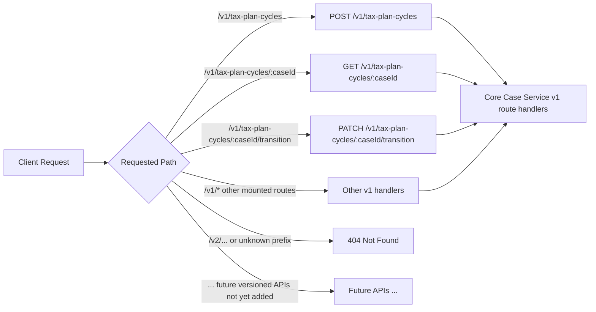

# ADR-0010: Version Tax Plan Cycle API under /v1

## Context
The Core Case Service exposes tenant-scoped Tax Plan Cycle endpoints that are consumed by
clients outside the repository. Those consumers need a stable public contract while the
service continues to evolve.

Before this decision, the Tax Plan Cycle create and read routes were mounted at the root
of the service. That made it harder to introduce future breaking changes without risking
unexpected client behavior. We also want the version boundary to fail closed so unknown
prefixes do not accidentally reach the current implementation.

## Decision
Serve the public Tax Plan Cycle endpoints under `/v1` and treat that prefix as the only
registered public API version for this surface.

The service will:
- mount the Tax Plan Cycle router under `/v1`,
- expose create and read as `/v1/tax-plan-cycles` and `/v1/tax-plan-cycles/{caseId}`,
- expose transition as `/v1/tax-plan-cycles/{caseId}/transition`,
- return `404` for unknown version prefixes because no fallback route will match them,
- keep `/openapi.json` unversioned while the document itself advertises the `/v1` paths.

## Consequences
This creates an explicit version boundary that gives the service room to evolve without
breaking existing consumers.

Benefits:
- clear public API shape for consumers and documentation,
- safer future evolution path for breaking route changes,
- predictable `404` behavior for unsupported prefixes,
- OpenAPI and runtime routes stay aligned.

Tradeoffs:
- clients must update to the versioned paths,
- route tests and integration helpers need to hardcode the version prefix,
- future versions must be added intentionally rather than by broad routing rules.

## Alternatives considered
- Keep the unversioned routes and rely on documentation only.
- Version the API with headers instead of path prefixes.
- Add a wildcard fallback that rewrites unknown versions to `/v1`.

## Diagram
