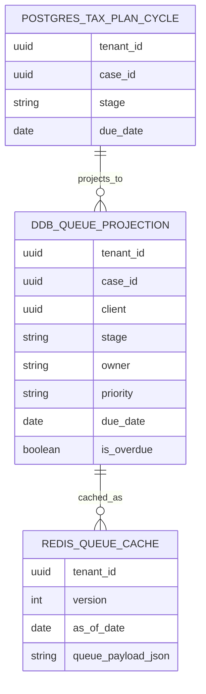
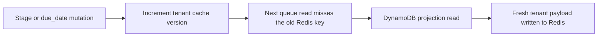

# ADR-0014: Redis cache-aside for Tax Plan Cycle Queue reads

## Context
The Plan Cycle Queue is now modeled as a DynamoDB read projection owned by the Core
Case Service, with Redis reserved for disposable queue-cache entries. The queue read
path needs to stay fast without making Redis authoritative or coupling the service to
key scans for invalidation.

The repository already keeps the queue projection contract in DynamoDB and the
mutation path in PostgreSQL. The remaining gap is a queue-read seam that first checks
Redis, then falls back to DynamoDB on a miss, and invalidates cache state whenever the
queue projection changes.

## Decision
Use Redis as a cache-aside layer in front of the DynamoDB queue projection.

The cache is tenant-scoped and versioned:

- each tenant has a version key in Redis,
- queue-read cache keys include the tenant ID, version, and `as_of_date`,
- invalidation is a version bump instead of a key scan,
- Redis payloads are disposable and may be rebuilt from DynamoDB at any time.

The queue-read service keeps the DynamoDB projection as the source of truth and
recomputes freshness from the queue record data. The cache stores the final queue
payload returned to callers, not a separate derived state.

Stage transitions already own a mutation seam, so they now bump the tenant cache
version after a successful transition. The due-date mutation path does not exist yet,
so the helper for that invalidation path is scaffolded now and will be wired when the
mutation lands.

## Consequences
Redis now sits in front of the DynamoDB queue projection as disposable operational
state. Queue reads get a fast cache hit path and still fall back to the projection
store on a miss.

RedisInsight is the preferred Docker-based developer tool for inspecting this cache.
Bookmark the local UI at `http://localhost:5540` when running the container-based
tooling flow.

If you prefer an in-container CLI, `docker exec -it <container-name> redis-cli` is a
supported option for interacting with the running Redis container directly.

Versioned tenant namespaces avoid key scans and make invalidation predictable.
Redis outages do not change the source of truth, but they may slow queue reads until
the cache repopulates.

The Core Case Service keeps the Postgres mutation path and the DynamoDB projection path
separate, which matches the storage decision matrix and leaves the queue cache easy to
swap or discard later.

## Alternatives considered
- Delete cache keys directly on every invalidation.
- Use DynamoDB alone without Redis.
- Store the queue cache in PostgreSQL.
- Rely on TTL-only cache expiry without explicit version bumps.
