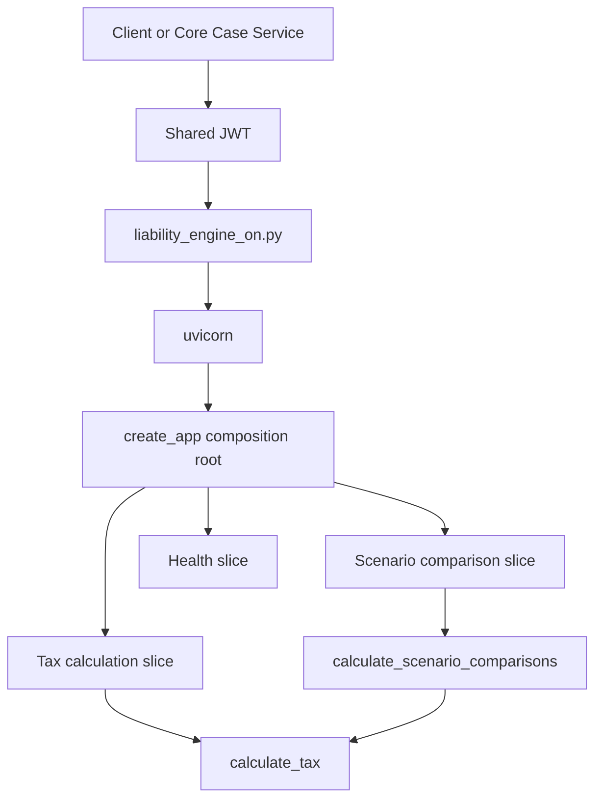
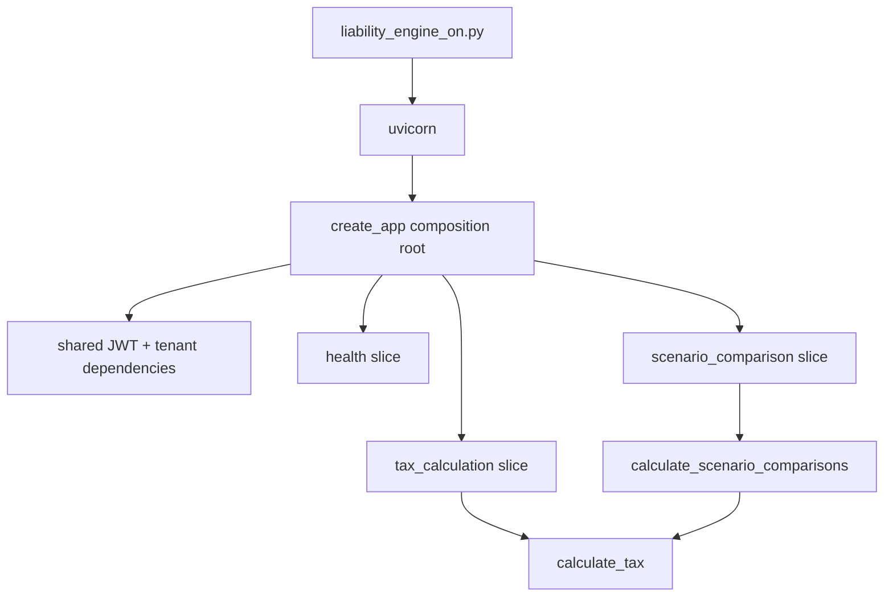

# ADR-0016: FastAPI Startup Convention for the Liability Engine

## Context
This ADR extends the existing FastAPI startup convention rather than replacing it.
The original startup path stays the source of truth, and this update adds the
feature-sliced HTTP layout as an architectural extension.

TaxPulse exposes liability and scenario calculations through a FastAPI boundary so the
Core Case Service can request real numbers over HTTP. The API must stay easy to start
locally, but it also needs an architecture that scales as more feature endpoints land.

`main.py` remains separate from HTTP startup for now. It is still the bootstrap entry
point for the DynamoDB and LocalStack-oriented startup path that already exists in the
repo, while the liability API keeps its own interpreter-run launcher. That separation is
intentional so the HTTP startup path stays explicit and easy to reason about.

The repository already models tenant-scoped case management in PostgreSQL and queue
projection state in DynamoDB. The liability engine itself does not own either store;
it only serves calculation responses to authenticated callers.

That design keeps separation of concerns and YAGNI intact:
- the HTTP service does not absorb unrelated bootstrap responsibilities,
- the launcher stays small and interpreter-friendly,
- future app composition can evolve without forcing `main.py` to become the API host.

## Decision
Use `python src/tax_liability_engine/scripts/liability_engine_on.py` as the canonical
local startup command for the liability engine.

The exact startup command is:
```bash
python src/tax_liability_engine/scripts/liability_engine_on.py
```
or from the scripts directory:
```bash
python liability_engine_on.py
```

That launcher will:
- load local environment variables from `.env` when present,
- import the FastAPI app composition root,
- start the app with `uvicorn`,
- keep API startup separate from `main.py`.

### Feature-Sliced Architecture Extension

The FastAPI application itself should follow a feature-sliced architecture:
- one app composition root that mounts routers and shared dependencies,
- one shared dependency module for JWT validation and tenant scoping,
- one router module per feature slice,
- pure domain math and comparison services stay outside the HTTP layer.

The feature-sliced boundaries for the current service are:
- `health`
- `tax_calculation`
- `scenario_comparison`
- future slices can be added without growing one central router file.

The startup convention is intentionally Python-native. PowerShell is not part of the
supported application behavior.

## Consequences
This keeps startup simple while making the API easier to extend, test, and review.

Problem spots:
`ERROR:    [Errno 10048] error while attempting to bind on address ('127.0.0.1', 8000): [winerror 10048] only one usage of each socket address (protocol/network address/port) is normally permitted` 

may crop up as port 8000 is common scenario, leverage `netstat` & `taskkill` carefully for local development bugs

Benefits:
- one clear interpreter-friendly launch path,
- a thin composition root instead of a monolithic `api.py`,
- route handlers stay close to their feature-specific request and response models,
- auth and tenant scoping stay shared and consistent across slices,
- future endpoint work can land as isolated feature modules.

Tradeoffs:
- the package will have a few more small HTTP modules instead of one central file,
- the launcher still carries a small amount of bootstrapping code that could later be
  absorbed into a broader startup flow if the project decides to merge concerns.

Operational note:
`ERROR: [Errno 10048] error while attempting to bind on address ('127.0.0.1', 8000)`
may appear if another local process already owns port 8000. Resolve the conflict before
restarting the service.

## Startup Diagram


## Feature-Sliced Layout Diagram


## Alternatives considered
- Keep a single monolithic `api.py` that owns every route.
- Fold the launcher into `main.py` immediately and make it the public startup path.
- Add a separate container orchestration layer for API startup now.
