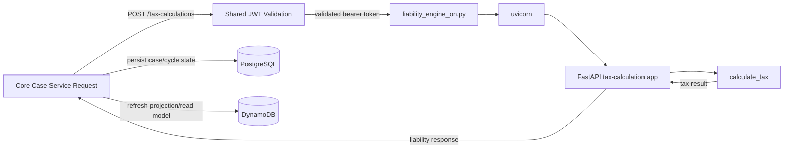

# ADR-0016: FastAPI Startup Convention for the Liability Engine

## Context
TaxPulse now exposes the liability calculation through a FastAPI service boundary so
the Core Case Service can request real numbers over HTTP. The startup path for that
service should be explicit, interpreter-runnable, and easy to keep separate from any
future bootstrap behavior that may be added to `main.py`.

`main.py` for now serves as an exclusive entry point for `DynamoDB + LocalStack` right now this logic is decoupled but may end up merged into a single-startup-script later in the project lifecycle.

For now enforcing clear separation of concerns and enforcing YAGNI with this new implementation takes priority

The repository already models tenant-scoped case management in PostgreSQL and queue
projection state in DynamoDB. The liability engine itself does not own either store;
it only serves calculation responses to authenticated callers.

## Decision
Use `python src/tax_liability_engine/scripts/liability_engine_on.py` as the canonical
local startup command for the liability engine.


The exact startup command is:
```bash
python src/tax_liability_engine/scripts/liability_engine_on.py
```
or from the scripts directory:
```bash
python liability_engine_on.py
```

That launcher will:
- load local environment variables from `.env` when present,
- import the FastAPI app factory,
- start the app with `uvicorn`,
- keep API startup separate from `main.py` for now.

The startup convention is intentionally Python-native. PowerShell is not part of the
supported application behavior.

## Consequences
This gives the service a single, interpreter-friendly launch path that is easy to run
from the shell, CI, or a future container entrypoint.

Problem spots:
`ERROR:    [Errno 10048] error while attempting to bind on address ('127.0.0.1', 8000): [winerror 10048] only one usage of each socket address (protocol/network address/port) is normally permitted` 

may crop up as port 8000 is common scenario, leverage `netstat` & `taskkill` carefully for local development bugs

Benefits:
- no PowerShell-specific dependency for app startup,
- startup behavior stays close to the Python package it launches,
- the launcher can later be folded into `main.py` if the architecture calls for it.

Tradeoffs:
- the launcher duplicates a small amount of bootstrapping code that could be absorbed
  into `main.py` later,
- developers must use the Python command path rather than a shell wrapper.

## Diagram


## Alternatives considered
- Keep a PowerShell startup wrapper as the public entrypoint.
- Fold the launcher into `main.py` immediately.
- Add a separate container orchestration layer for API startup now.
