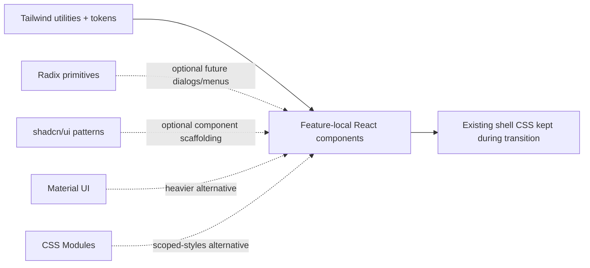

# ADR-0019: Tailwind Styling Foundation for Pulse UI

## Context
The Pulse UI shell started with custom CSS for navigation and frame layout, but the
first product page now needs a scalable styling approach that stays readable for a
small team and keeps component code close to the rendered structure.

For this project, the styling layer should be:

- easy to adopt incrementally,
- lightweight at runtime,
- compatible with a long-lived enterprise codebase,
- and friendly to future accessibility primitives without forcing a heavyweight UI kit.

## Decision
Use Tailwind CSS as the primary styling foundation for `src/pulseUI`.

The queue page and later feature pages can use utility classes for layout, spacing,
typography, and responsive behavior while the shared shell stylesheet lives in
`src/pulseUI/shared/styles.css` and remains the base frame styling during the
incremental migration.

Tailwind is preferred over CSS Modules for this stage because the team wants a
compact implementation path that can scale from the first page without a future
refactor from locally scoped CSS files to utility-based layout conventions.

Material UI remains a valid enterprise choice, but it adds a larger component system
and opinionated visual layer than this project currently needs.

CSS Modules remain a reasonable fallback for isolated styling, but they are less
useful when the goal is to establish a consistent utility-driven component workflow
across a growing React surface.

Radix and shadcn-style primitives are still useful later if the application needs
more complex, accessible interactive controls. They do not need to be adopted on day
one to justify the Tailwind base.

## Consequences
The Pulse UI can ship a clean first page without committing to a heavyweight design
system.

Existing shell styles remain valid in `shared/styles.css`, so the migration can be
incremental rather than a rewrite.

Tailwind introduces build-time styling tooling, but it keeps runtime cost low and
supports a modular component layout that can grow with the UI.

## Alternatives considered
- Continue with handwritten global CSS only.
- Move to CSS Modules as the primary styling model.
- Adopt Material UI for the whole operator workspace.
- Delay the styling decision and continue expanding ad hoc CSS.
