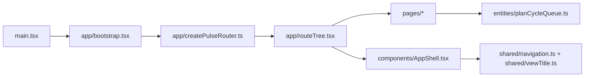

# ADR-0020: Pulse UI Layered Application Structure

## Context
The Pulse UI started as a small shell under `src/pulseUI` with route definitions,
navigation data, shell layout, and the first page all grouped in feature-oriented
folders. That worked for the initial bootstrap, but it did not make the application
shape obvious as the first real page landed.

The team wants a more standard layered React structure that is easy to explain in a
larger enterprise environment:

- `app/` for application startup and router composition,
- `pages/` for route-target screens (layered by feature),
- `components/` for reusable UI blocks (plugs into features but not broken up by them),
- `entities/` for typed business models,
- `shared/` for reusable application infrastructure and configuration.

## Decision
Reorganize `src/pulseUI` around the layered application contract above.

Place navigation metadata and route-title lookup in `shared/`.
Keep bootstrap and route wiring in `app/`.
Keep screen-level route targets in `pages/`.
Keep the shell layout and other reusable chrome in `components/`.
Keep typed UI/business models in `entities/` when they are shared across screens.

This structure makes the ownership boundaries visible without forcing every UI piece
into the same folder. The queue page remains feature-specific, but the application
shell and navigation now live in the homes that match their role.

The test tree stays rooted at `src/pulseUI/tests/` for now, with feature-specific
subfolders only where they improve isolation.

## Consequences
The app becomes easier to navigate for engineers who expect a layered React layout.

Router setup and app bootstrap are no longer mixed into the route-target screen code.

Navigation configuration is shared rather than embedded in the shell component.

This is an organizational cutover only. The rendered UI and routing behavior stay the
same.

## Alternatives considered
- Keep the current feature-slice layout under `src/pulseUI/features`.
- Move only the page and leave routing/nav together in the old folders.
- Split the app into even more granular technical folders immediately.
