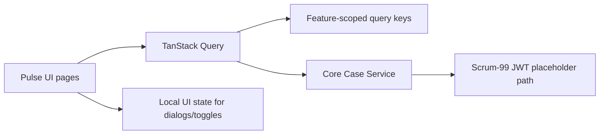

# ADR-0021: Use TanStack Query for Pulse UI server state

## Context
The Pulse UI now needs live reads for the Tax Plan Cycle queue and detail screens.
Those screens must fetch server state without duplicating it into local React state,
and the implementation needs predictable loading, error, refetch, and cache behavior.

The project already uses TanStack Router for route composition, and the queue/detail
screens are a natural fit for TanStack Query as the server-state layer.

## Decision
Use `@tanstack/react-query` as the server-state layer for Pulse UI reads.

Keep `useState` for transient UI concerns such as dialogs, toggles, and local view
controls. Keep TanStack Query responsible for request lifecycle, cache identity,
error propagation, refetch behavior, and invalidation.

Treat query keys as stable cache primary keys, not arbitrary labels. For the Tax Plan
Cycle slice, use feature-scoped keys under the `taxPlanCycle` namespace so queue and
detail queries remain isolated and easy to invalidate.

Gate the UI-layer JWT verification path behind the Scrum-99 placeholder comment for
now. The live fetch boundary should reject unauthorized requests cleanly, but the
actual refresh-on-401 behavior is deferred until the auth work is implemented.

## Consequences
Loading, empty, error, and retry states become explicit and testable without mixing
server data into component state.

The queue and detail screens can fetch independently while still sharing the same
feature-local query conventions.

Future mutations can invalidate related queries instead of manually patching cached
payloads, which keeps the client aligned with the server.

The UI adds one more dependency, but it is a targeted dependency that matches the
screen requirements and reduces bespoke data-loading code.

## Alternatives considered
- Keep using `useState` and effect-based fetch logic.
- Introduce Redux or Zustand for server data.
- Defer live fetching until the auth work is complete.
