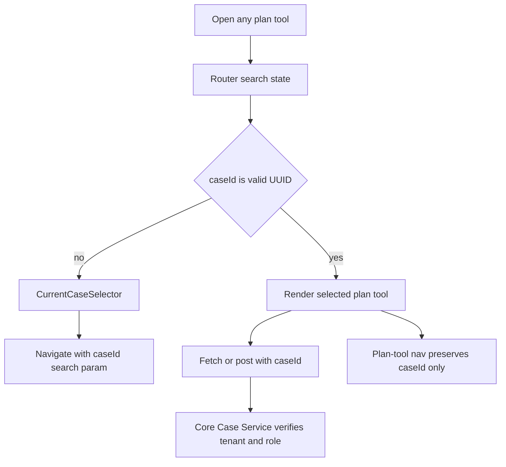

# ADR-0026: Route-Driven Case Context for Plan Tools

## Context
Pulse UI plan tools operate on Tax Plan Cycle case data. Deductions and scenario
modeling already use case-scoped Core Case Service endpoints, while quarterly
payments and income are still placeholder-backed surfaces. The UI had no shared
flow for choosing the Tax Plan Cycle primary key before entering those tools, which
made fetch behavior depend on page-local placeholders.

The implementation must keep Tax Plan Cycle as the case boundary, preserve tenant
isolation, and avoid adding a second durable source of truth for selected case
state.

## Decision
Use TanStack Router search state as the source of truth for the selected plan-tool
case. Planning tool routes accept an optional `caseId` search parameter, normalize it
as a UUID, and block page fetch or mutation behavior until a valid case ID exists.

Any planning tool can initialize the selection by rendering a shared selector that
loads accessible Tax Plan Cycles from `GET /v1/tax-plan-cycles` and navigates to the
current route with `?caseId=<uuid>`. Planning tool navigation preserves only this
validated `caseId` across Income, Deductions, Scenarios, and Quarterly Payments.

Tenant and role scoping remain backend-authoritative. The UI gate prevents accidental
unscoped fetches, but it is not a security boundary.

## Consequences
Refreshes and direct links keep the selected case because the case ID is encoded in
the URL. Moving between plan tools carries the selected case without relying on a
global store or requiring a first tool to be used.

The selector must only display cases returned by tenant-scoped backend reads. If
Advisor or Client scoping is not fully enforced by the service yet, that remains a
backend authorization gap to close rather than something the UI can solve safely.

Search propagation must stay limited to plan tools so unrelated screens do not carry
case context accidentally.

Client name is unreachable, client entity does not exist so going off ID is the only means of accomplishing this. Client entity design most likely in another task scoped to client roster.

Implementation Does NOT scale with large numbers of cases, a giant list of 100+ items to navigate in just a drop down is cumbersome and bad ux, behavior can be ported into a new page or component later if needed as a new ticket, functionality needs functional skeleton to move forward

## Alternatives considered
- Store selected case in React context or global state. 
    - Rejected, constraint violation
- Persist selected case in local storage. 
    - Rejected, tanstack query design anti-pattern
- Move all tools under case-path routes such as `/cycles/:caseId/deductions`.
    - Rejected, tools MUST be independent of one another, there is no gated or controlled flow for how a user works with a case. Usuability violation
- CurrentCaseProvider simply stores currentCaseID and exposes a hook for setting it via the toolbar.
    - Rejected, Tradeoff: In memory it'll be lost on refresh or new tab, memoization does not assist with this. Approach should bind domain to it's enforcer which is router

### Implementations considered
- Idea 1: URL-backed CurrentCaseSelector + CurrentCaseProvider
- Idea 2: Tool gateway screen
- Idea 3: route-search driven case context (selected)