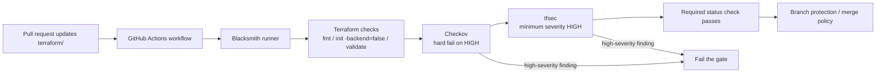

# ADR-0033: Terraform Security Gate on Blacksmith Runners

## Context

SCRUM-163 adds a PR-time security gate for the seeded Terraform root from SCRUM-162.
The goal is to catch Terraform misconfigurations before apply by running the
configuration through formatting, validation, and two security scanners:
Checkov and tfsec.

The repo already uses GitHub Actions and Blacksmith-backed runners. The new gate needs
to be enforceable as a normal PR check, but it should not depend on live AWS state or
stable VPC/container addresses while the Terraform implementation is still being
seeded.

The expected behavior is:

- pull requests that touch Terraform trigger the gate,
- the workflow runs on a Blacksmith Linux runner,
- the Terraform root is checked statically,
- high-severity findings fail the check, and
- branch protection can consume the workflow result as a required status check.

## Decision

Add a dedicated GitHub Actions workflow for Terraform security gating and run it on a
Blacksmith Linux runner.

The workflow will:

- run on `blacksmith-2vcpu-ubuntu-2404`,
- restrict its trigger to Terraform paths and the workflow file itself,
- format-check the Terraform root,
- run `terraform init -backend=false` and `terraform validate`,
- run Checkov against the Terraform directory with a high-severity failure threshold,
- run tfsec against the same Terraform directory with a high-severity floor, and
- keep the gate static so it does not require AWS credentials for the current story.

The gate is intentionally enforcement-only. It does not add apply, plan, or AWS
mutation behavior, and it does not introduce any agent configuration.

The Terraform implementation is expected to clear the real findings directly:

- enable RDS storage encryption,
- enable DynamoDB server-side encryption,
- scope security-group egress to the VPC instead of the public internet, and
- keep public subnet auto-IP assignment explicit with documented suppressions.

### Architecture diagram

## Consequences

Terraform changes now have a static security gate before merge. That reduces the chance
of merging obvious infrastructure misconfigurations while the Terraform stack continues
to be seeded.

Because the gate runs on Blacksmith, the workflow benefits from the repo's existing
runner setup without needing custom runner infrastructure. The repo still needs the
Blacksmith app installed and branch protection configured so the workflow result can
block merges.

The gate will remain useful as the Terraform tree grows, but future modules or
live-environment steps may require additional rules, credentials, or a separate
deployment workflow.

## Alternatives considered

- Rely on local `terraform validate` and skip CI enforcement.
- Run security scans only after `terraform apply`.
- Depend on AWS credentials for every gate run.
- Add agent automation instead of a deterministic GitHub Actions workflow.
