# Architecture Decision Records

This directory captures durable architecture and domain decisions for TaxPulse.

## Index
- [ADR-0001: Tax Plan Cycle condition lives in stage](./0001-condition-lives-in-stage.md)
- [ADR-0002: Pyright Testing with Ruff](./0002-pyright-testing.md)
- [ADR-0003: AsyncIO Testing Utility](./0003-asyncio-testing.md)
- [ADR-0004: Testcontainers](./0004-Testcontainers.md)
- [ADR-0005: Use drizzle-seed for deterministic synthetic seed data](./0005-drizzle-seed-installation.md)
- [ADR-0006: Use Vitest coverage-v8 for TypeScript coverage reporting](./0006-vitest-coverage-v8.md)
- [ADR-0007: Use Argon2id for password login verification](./0007-argon2id-password-login.md)

```mermaid
graph TD
  A[express-app/]

  A --> B[src/]
  A --> C[test/]
  A --> D[package.json]
  A --> E[tsconfig.json]
  A --> F[eslint.config.mjs]
  A --> G[README.md]

  B --> B1[app.ts]
  B --> B2[server.ts]
  B --> B3[config/]
  B --> B4[auth/]
  B --> B5[features/]
  B --> B6[middleware/]
  B --> B7[services/]
  B --> B8[types/]
  B --> B9[utils/]

  B3 --> B31[index.ts]
  B3 --> B32[env.ts]

  B4 --> B41[index.ts]
  B4 --> B42[requireAuth.ts]
  B4 --> B43[auth.types.ts]

  B5 --> B51[feature-a/]
  B5 --> B52[feature-b/]

  B51 --> B511[index.ts]
  B51 --> B512[controller.ts]
  B51 --> B513[service.ts]
  B51 --> B514[route.ts]
  B51 --> B515[repository.ts]

  B52 --> B521[index.ts]
  B52 --> B522[controller.ts]
  B52 --> B523[service.ts]
  B52 --> B524[route.ts]
  B52 --> B525[repository.ts]

  B6 --> B61[error-handler.ts]
  B6 --> B62[request-logger.ts]
  B6 --> B63[not-found.ts]

  B7 --> B71[feature-a.service.ts]
  B7 --> B72[feature-b.service.ts]
  B7 --> B73[audit.service.ts]

  C --> C1[unit/]
  C --> C2[integration/]
  C --> C3[e2e/]

  C1 --> C11[feature-a.test.ts]
  C1 --> C12[feature-b.test.ts]
  C1 --> C13[auth.test.ts]

  C2 --> C21[app.test.ts]
  C2 --> C22[routes.test.ts]

  C3 --> C31[api.spec.ts]
```

