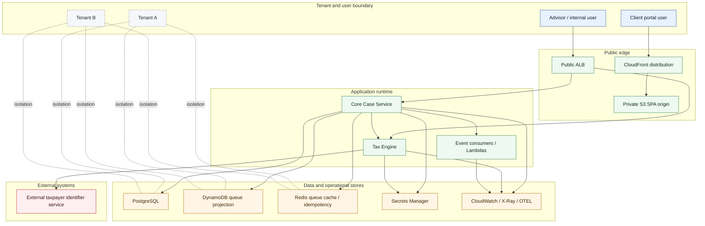
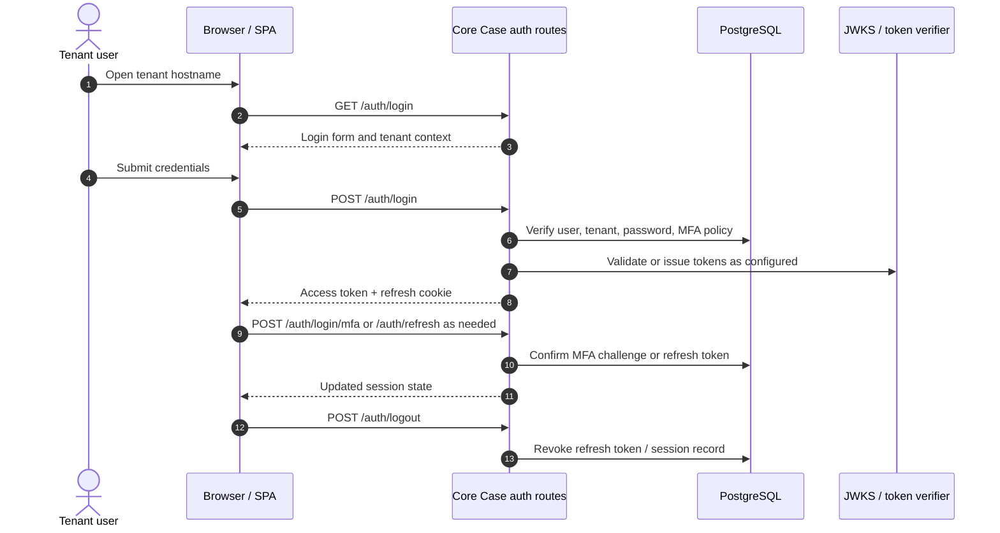
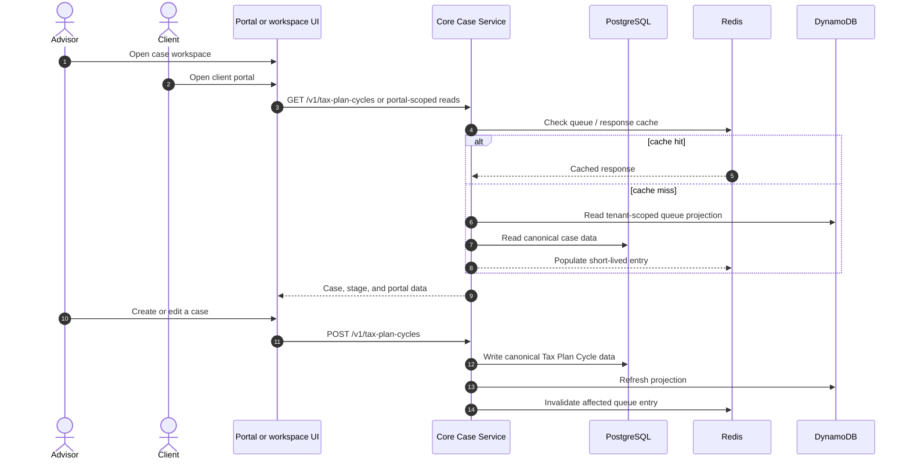
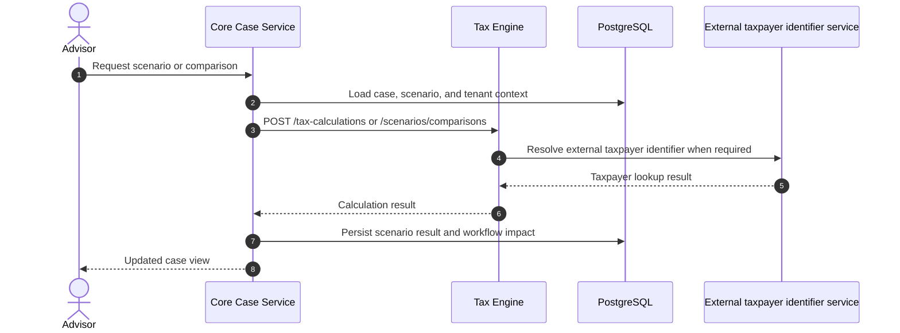
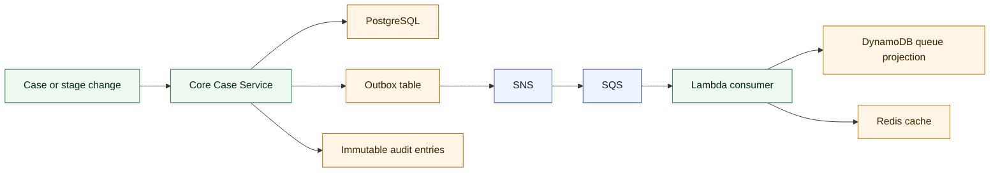
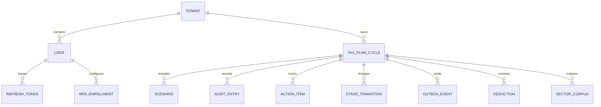
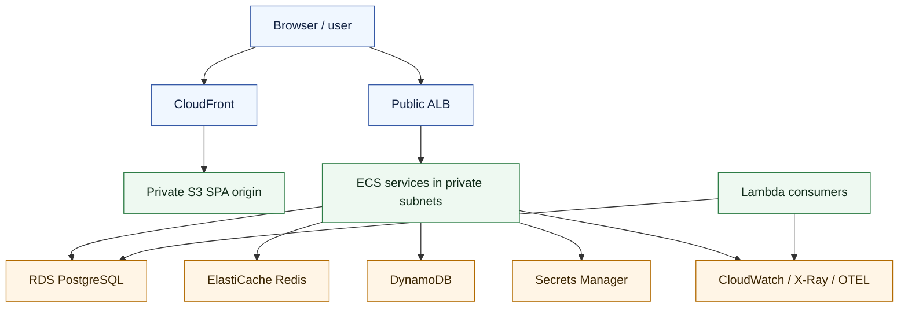

# TaxPulse Data Flow

## Context

TaxPulse Advisory is a multi-tenant tax planning workspace with three main user
paths:

- advisors working inside the core case workspace,
- clients using the tenant-scoped portal,
- platform services handling authentication, case workflow, calculations, events,
  and audit history.

This document captures the current and intended data flow across those paths. It is
written to match the direct, architecture-first style used in the ADRs while keeping
the Mermaid diagrams as the primary source of truth for system shape.

The modeled scope includes:

- tenant discovery and authentication,
- the versioned Core Case Service API,
- the Tax Engine calculation service,
- the client portal distribution path,
- persistent stores and operational caches,
- event-driven workflow side effects,
- external taxpayer identifier integration,
- observability and secrets boundaries.

## Scope and notation

The diagrams intentionally separate these trust boundaries:

- external user versus internal service,
- tenant A versus tenant B,
- public edge versus private runtime,
- Core Case Service versus Tax Engine,
- application services versus persistent stores,
- TaxPulse services versus external integrations.

Some flows are conditional or future-facing. When a route is not guaranteed on every
deployment path, the diagram labels it as such instead of presenting it as a single
hardcoded runtime rule.

## System context

## Authentication and session flow

## Portal and case workspace flow

## Calculation flow

## Workflow, audit, and event flow

## Storage ownership

## Operational and deployment flow

## Coverage notes

This document covers the diagrammed flows that matter for the current TaxPulse
architecture:

- login, MFA, refresh, and logout,
- advisor workspace and client portal access,
- tenant-scoped case reads and writes,
- case calculation handoff to the Tax Engine,
- transactional persistence and immutable audit history,
- outbox-driven event propagation,
- queue projection and cache coordination,
- external taxpayer lookup,
- runtime secrets and observability boundaries.

The document is intentionally detailed enough to support the threat-modeling and
architecture review work that depends on a complete data-flow picture. If future work
changes the routing between the ALB, Core Case Service, and Tax Engine, those changes
should be reflected here before the diagram is treated as a release artifact.
