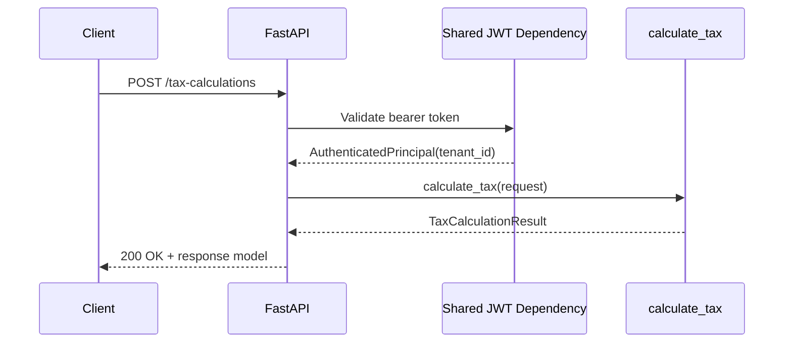

# Caleb Latimer Ticket Journal

**Owner:** Caleb Latimer  
**Branch prefix:** `caleb-latimer-`

Add new ticket entries below using this template.

<!--
## caleb-latimer-jiraXX - SCRUM-XX

**Branch:** `caleb-latimer-jiraXX`

**Assignee:** Caleb Latimer

**Jira Key:** SCRUM-XX

**Summary:**

**Description:**

**Acceptance Criteria:**

-

**Code Connection:**

**Project Scope Connection:**

**Changed Files:**

-

**Validation Notes:**

-
-->
## caleb-latimer-jira84 - SCRUM-84

**Branch:** `caleb-latimer-jira84`

**Assignee:** Caleb Latimer

**Jira Key:** SCRUM-84

**Summary:** Expose the tax calculation via a FastAPI endpoint

**Description:** As an Advisor, I want the calculation exposed via a JWT-protected
FastAPI endpoint, so that the Core service can request real numbers.

**Acceptance Criteria:**

- A POST endpoint accepts the calculation request and returns the response model.
- The endpoint requires a valid shared JWT and is tenant-scoped.
- An httpx test asserts a sample request returns the expected liability.

**Sequence Diagram:**

**Code Connection:** `src/python/tax_pulse_project_team_1/api.py` now owns the
FastAPI app factory and the `/tax-calculations` route, reusing the existing shared JWT
dependency and the pure `calculate_tax` engine. The new HTTP test exercises the ASGI
app through `httpx` and verifies the response model and liability output.

**Project Scope Connection:** This delivers the Polyglot Backend & Contracts ticket by
exposing the Python tax engine as the tenant-scoped service endpoint the Core service
can call without changing the calculation math contract or introducing persistence.

**Changed Files:**

- `src/python/tax_pulse_project_team_1/api.py`
- `src/python/tax_pulse_project_team_1/__init__.py`
- `tests/python/test_tax_calculation.py`
- `tests/python/test_tax_calculation_api.py`
- `src/tax_liability_engine/scripts/liability_engine_on.py`
- `adr/0016-fastapi-startup-convention.md`
- `docs/postman/jira84-tax-calculation.postman_collection.json`
- `docs/postman/jira84-tax-calculation.postman_environment.json`
- `README.md`
- `pyproject.toml`

**Validation Notes:**

- `.\.venv\Scripts\python.exe -m ruff check src/python tests/python` passed.
- `.\.venv\Scripts\python.exe -m pyright --pythonpath .\.venv\Scripts\python.exe`
  passed.
- `.\.venv\Scripts\python.exe -m pytest tests/python/test_tax_calculation.py
  tests/python/test_tax_calculation_api.py tests/python/test_jwt_authentication.py
  tests/python/test_scenario_comparison.py tests/python/test_tax_brackets.py
  tests/python/test_tax_bracket_schedules.py tests/python/test_smoke.py
  tests/python/queue_projection/test_models.py
  tests/python/queue_projection/test_service.py` passed: 60 tests.
- `python src/tax_liability_engine/scripts/liability_engine_on.py` launched the API and returned
  `{"status":"ok"}` from `GET /health`.
- `.\.venv\Scripts\python.exe -m pytest` still hits the existing Docker/LocalStack
  prerequisite failure in `tests/python/test_plan_cycle_queue_projection.py` because
  the host machine does not have a running Docker daemon.
