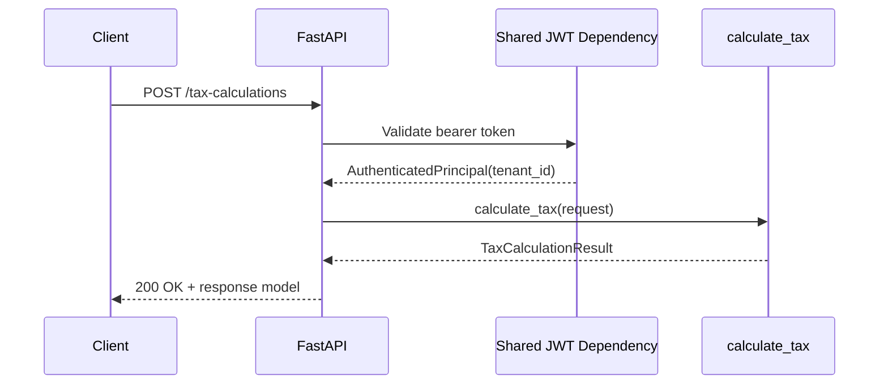
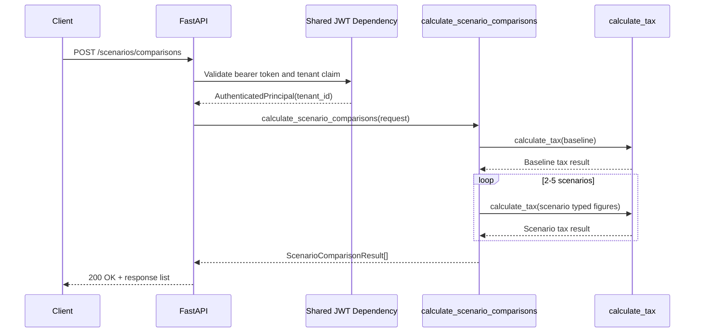
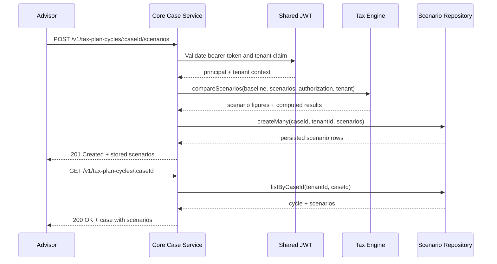

# Caleb Latimer Ticket Journal

**Owner:** Caleb Latimer  
**Branch prefix:** `caleb-latimer-`

Add new ticket entries below using this template.

<!--
## caleb-latimer-jiraXX - SCRUM-XX

**Branch:** `caleb-latimer-jiraXX`

**Assignee:** Caleb Latimer

**Jira Key:** SCRUM-XX

**Summary:**

**Description:**

**Acceptance Criteria:**

-

**Code Connection:**

**Project Scope Connection:**

**Changed Files:**

-

**Validation Notes:**

-
-->

## caleb-latimer-jira74 - SCRUM-74

**Branch:** `caleb-latimer-jira74`

**Assignee:** Caleb Latimer

**Jira Key:** SCRUM-74

**Summary:** Project Tax Plan Cycle changes into the queue table

**Description:** As a Backend Developer, I want cycle changes projected into the DynamoDB queue, so that the read model stays consistent with the case.

**Acceptance Criteria:**

- Creating or updating a cycle upserts its queue projection item.
- The queue projection item uses the tenant/case key contract and preserves the projected case fields.
- The LocalStack-backed queue table can be created and queried in tests.
- The Python queue-projection tests pass with the repository validation flow.

**Code Connection:**

- `src/tax_liability_engine/tax_plan_cycle_queue_projection.py`
- `src/tax_liability_engine/dynamodb/plan_cycle_queue_projection.py`
- `tests/tax_liability_engine/tax_plan_cycle_queue_projection/test_service.py`
- `tests/tax_liability_engine/test_plan_cycle_queue_projection.py`

**Project Scope Connection:**

- Polyglot Backend & Contracts
- Tax Plan Cycle queue projection read-model work

**Changed Files:**

- `src/tax_liability_engine/`
- `tests/tax_liability_engine/`
- `README.md`
- `CONTRIBUTING.md`
- `setup.sh`
- `pyproject.toml`
- `adr/0013-tax-liability-engine-namespace-refactor.md`

**Validation Notes:**

- `.\.venv\Scripts\python.exe -m pytest --cache-clear`
- `.\.venv\Scripts\python.exe -m pytest --basetemp=.pytest-tmp`
- `python -m pytest --cache-clear` in PowerShell also passed after the dev environment was installed
- LocalStack integration tests are wired through testcontainers and skip when Docker is not reachable in the current shell

## caleb-latimer-jira75 - SCRUM-75

**Branch:** `caleb-latimer-jira75`

**Assignee:** Caleb Latimer

**Jira Key:** SCRUM-75

**Summary:** Cache the queue read in Redis with invalidation

**Description:** As an Advisor, I want the Plan Cycle Queue cached in Redis, so that the queue loads fast without hammering the read store.

**Acceptance Criteria:**

- Queue reads check Redis first and fall back to DynamoDB on a miss.
- A cache entry is invalidated when a case's stage or due_date changes.
- A test asserts a stale entry is not served after an invalidating change.

**Code Connection:**

- `src/typescript/taxPlanCycleQueueProjection.ts`
- `src/typescript/taxPlanCycleQueueCache.ts`
- `src/typescript/taxPlanCycleQueueDynamoStore.ts`
- `src/typescript/taxPlanCycleQueueReadService.ts`
- `src/typescript/taxPlanCycleTransitionController.ts`
- `tests/typescript/bootstrap/dockerRedis.ts`
- `tests/typescript/taxPlanCycleQueueCache.test.ts`
- `tests/typescript/taxPlanCycleQueueDynamoStore.test.ts`
- `tests/typescript/taxPlanCycleQueueRead.integration.ts`

**Project Scope Connection:**

- Polyglot Backend & Contracts
- Core Case Service queue-read cache-aside work

**Changed Files:**

- `src/typescript/`
- `tests/typescript/`
- `README.md`
- `.env.example`
- `package.json`
- `adr/0014-redis-cache-aside-queue-reads.md`
- `adr/README.md`

**Validation Notes:**

- Scaffolding was completed in the sandbox, but the new npm dependencies still need to be installed locally before `npm run typecheck`, `npm test`, and `npm run test:integration` can be executed.
- New queue-cache tests were added under the Tax Plan Cycle feature slice so the Redis coverage can be run directly with Vitest after install.
## caleb-latimer-jira84 - SCRUM-84

**Branch:** `caleb-latimer-jira84`

**Assignee:** Caleb Latimer

**Jira Key:** SCRUM-84

**Summary:** Expose the tax calculation via a FastAPI endpoint

**Description:** As an Advisor, I want the calculation exposed via a JWT-protected
FastAPI endpoint, so that the Core service can request real numbers.

**Acceptance Criteria:**

- A POST endpoint accepts the calculation request and returns the response model.
- The endpoint requires a valid shared JWT and is tenant-scoped.
- An httpx test asserts a sample request returns the expected liability.

**Sequence Diagram:**

**Code Connection:** `src/python/tax_pulse_project_team_1/app.py` now owns the FastAPI
composition root, `src/python/tax_pulse_project_team_1/api.py` keeps the compatibility
import surface, and the `/tax-calculations` route lives in the feature slice under
`src/python/tax_pulse_project_team_1/routers/tax_calculation.py`. The new HTTP test
exercises the ASGI app through `httpx` and verifies the response model and liability
output.

**Project Scope Connection:** This delivers the Polyglot Backend & Contracts ticket by
exposing the Python tax engine as the tenant-scoped service endpoint the Core service
can call without changing the calculation math contract or introducing persistence.

**Changed Files:**

- `src/python/tax_pulse_project_team_1/api.py`
- `src/python/tax_pulse_project_team_1/app.py`
- `src/python/tax_pulse_project_team_1/dependencies.py`
- `src/python/tax_pulse_project_team_1/routers/__init__.py`
- `src/python/tax_pulse_project_team_1/routers/health.py`
- `src/python/tax_pulse_project_team_1/routers/tax_calculation.py`
- `src/python/tax_pulse_project_team_1/routers/scenario_comparison.py`
- `src/python/tax_pulse_project_team_1/jwt_authentication.py`
- `src/python/tax_pulse_project_team_1/__init__.py`
- `tests/python/test_tax_calculation.py`
- `tests/python/test_tax_calculation_api.py`
- `tests/python/test_plan_cycle_queue_projection.py`
- `src/tax_liability_engine/scripts/liability_engine_on.py`
- `adr/0016-fastapi-startup-convention.md`
- `docs/postman/jira84-tax-calculation.postman_collection.json`
- `docs/postman/jira84-tax-calculation.postman_environment.json`
- `README.md`
- `pyproject.toml`

**Validation Notes:**

- `.\.venv\Scripts\python.exe -m ruff format --check src/python tests/python` passed.
- `.\.venv\Scripts\python.exe -m pyright --pythonpath .\.venv\Scripts\python.exe`
  passed.
- `.\.venv\Scripts\python.exe -m pytest tests/python/test_tax_calculation_api.py
  tests/python/test_scenario_comparison_api.py` passed: 11 tests passed.
- `python src/tax_liability_engine/scripts/liability_engine_on.py` launched the API and returned
  `{"status":"ok"}` from `GET /health`.
- `.\.venv\Scripts\python.exe -m pytest` passed: 74 tests passed, 2 skipped.

## caleb-latimer-jira87 - SCRUM-87

**Branch:** `caleb-latimer-jira87`

**Assignee:** Caleb Latimer

**Jira Key:** SCRUM-87

**Summary:** Expose the scenario comparison HTTP endpoint

**Description:** As an Advisor, I want a scenario endpoint, so that scenario
comparisons can be requested over HTTP.

**Acceptance Criteria:**

- A POST endpoint accepts a baseline plus 2-5 scenarios and returns each scenario's
  total tax and delta.
- The endpoint enforces the 2-5 bound and returns 422 otherwise.
- An httpx test asserts a 3-scenario request returns three deltas.

**Sequence Diagram:**

**Code Connection:** `src/python/tax_pulse_project_team_1/app.py` now composes the
FastAPI application, `src/python/tax_pulse_project_team_1/api.py` preserves the public
import surface, and the tenant-scoped `/scenarios/comparisons` route lives in
`src/python/tax_pulse_project_team_1/routers/scenario_comparison.py`. The slice
reuses the shared JWT dependency pattern from Jira-84 and delegates all math to
`calculate_scenario_comparisons` without wrapping or altering the result model.

**Project Scope Connection:** This delivers the transport layer for the scenario
comparison contract that Jira-86 introduced in the Python service. It stays within the
Polyglot Backend & Contracts workstream, does not add persistence, and preserves the
existing calculation math contract.

**Changed Files:**

- `src/python/tax_pulse_project_team_1/api.py`
- `src/python/tax_pulse_project_team_1/app.py`
- `src/python/tax_pulse_project_team_1/dependencies.py`
- `src/python/tax_pulse_project_team_1/routers/__init__.py`
- `src/python/tax_pulse_project_team_1/routers/health.py`
- `src/python/tax_pulse_project_team_1/routers/tax_calculation.py`
- `src/python/tax_pulse_project_team_1/routers/scenario_comparison.py`
- `tests/python/test_tax_calculation_api.py`
- `tests/python/test_scenario_comparison_api.py`
- `planning/team/cl-ticket-journal.md`
- `planning/prompt-journal/cl-journal.md`

**Validation Notes:**

- `.\.venv\Scripts\python.exe -m ruff format --check src/python tests/python` passed.
- `.\.venv\Scripts\python.exe -m pyright --pythonpath .\.venv\Scripts\python.exe`
  passed with 0 errors and 0 warnings.
- `.\.venv\Scripts\python.exe -m pytest tests/python/test_tax_calculation_api.py
  tests/python/test_scenario_comparison_api.py` passed: 11 tests passed.
- `.\.venv\Scripts\python.exe -m pytest` passed: 74 tests passed, 2 skipped.

## caleb-latimer-jira90 - SCRUM-90

**Branch:** `caleb-latimer-jira90`

**Assignee:** Caleb Latimer

**Jira Key:** SCRUM-90

**Summary:** Call the Tax Engine from Core through the Node HTTP client and persist modeled scenario results

**Description:** As an Advisor, I want modeling on a cycle to call the Tax Engine through the Core service, so that results are persisted on the case.

**Acceptance Criteria:**

- A scenario-modeling request on a case in Modeling stage calls the engine using the Node service's native HTTP client with a per-call timeout and bounded retries, and stores the returned figures.
- The call carries the shared JWT and tenant context.
- The stored scenario results are returned on a subsequent case read.

**Sequence Diagram:**

**Code Connection:** `src/typescript/features/taxPlanCycle/routes.ts` now exposes the modeling POST and read-back flow, `src/typescript/features/taxPlanCycle/scenarioModelingController.ts` owns the engine call and persistence handoff, `src/typescript/taxEngineClient.ts` provides the native HTTP client with timeout and retry handling, `src/typescript/scenarioRepository.ts` stores and lists scenario rows, and `src/typescript/coreCaseOpenApi.ts` documents the new request and response shapes. `src/typescript/index.ts` wires the runtime composition and exports the widened read response type.

**Project Scope Connection:** This sits in the Polyglot Backend & Contracts workstream and extends the Core Case Service scenario-modeling slice so the TypeScript service can broker engine calls and persist the modeled figures without changing the tax math contract itself.

**Changed Files:**

- `src/typescript/features/taxPlanCycle/routes.ts`
- `src/typescript/features/taxPlanCycle/scenarioModelingController.ts`
- `src/typescript/scenarioModeling.ts`
- `src/typescript/taxEngineClient.ts`
- `src/typescript/scenarioRepository.ts`
- `src/typescript/coreCaseOpenApi.ts`
- `src/typescript/features/taxPlanCycle/taxPlanCycle.ts`
- `src/typescript/index.ts`
- `tests/typescript/features/taxPlanCycle/routes.test.ts`
- `tests/typescript/features/taxPlanCycle/mainComposition.test.ts`
- `.env.example`
- `README.md`
- `planning/team/cl-ticket-journal.md`
- `planning/prompt-journal/cl-journal.md`

**Validation Notes:**

- `cmd /c "set PATH=C:\nvm4w\nodejs;%PATH% && npm.cmd run typecheck"` passed.
- `cmd /c "set PATH=C:\nvm4w\nodejs;%PATH% && npm.cmd test"` passed: 45 test files passed, 1 skipped; 201 tests passed, 1 skipped.
