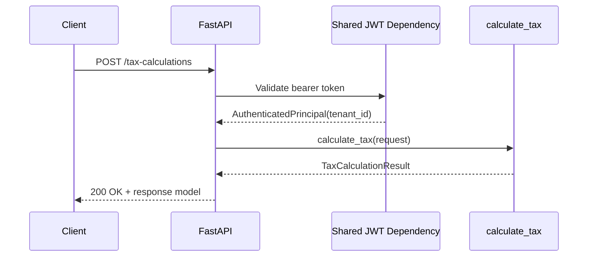
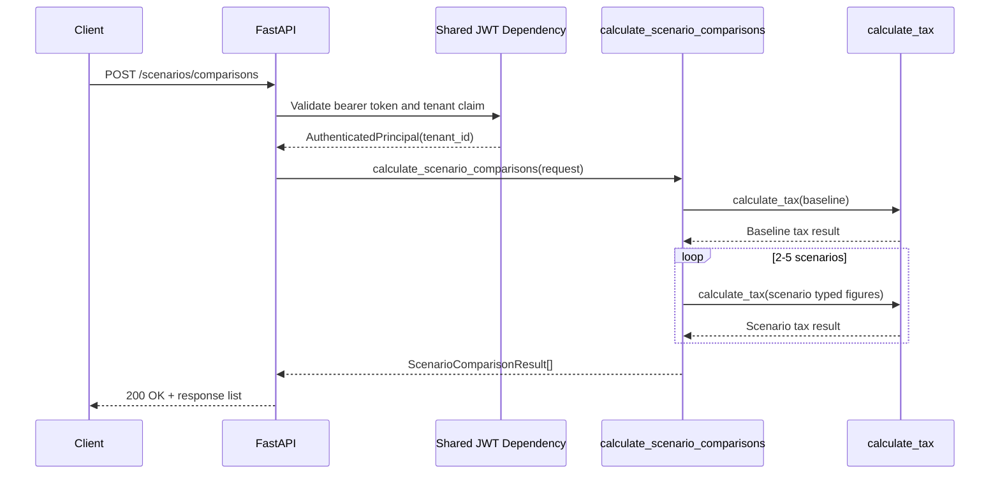

# Caleb Latimer Ticket Journal

**Owner:** Caleb Latimer  
**Branch prefix:** `caleb-latimer-`

Add new ticket entries below using this template.

<!--
## caleb-latimer-jiraXX - SCRUM-XX

**Branch:** `caleb-latimer-jiraXX`

**Assignee:** Caleb Latimer

**Jira Key:** SCRUM-XX

**Summary:**

**Description:**

**Acceptance Criteria:**

-

**Code Connection:**

**Project Scope Connection:**

**Changed Files:**

-

**Validation Notes:**

-
-->
## caleb-latimer-jira84 - SCRUM-84

**Branch:** `caleb-latimer-jira84`

**Assignee:** Caleb Latimer

**Jira Key:** SCRUM-84

**Summary:** Expose the tax calculation via a FastAPI endpoint

**Description:** As an Advisor, I want the calculation exposed via a JWT-protected
FastAPI endpoint, so that the Core service can request real numbers.

**Acceptance Criteria:**

- A POST endpoint accepts the calculation request and returns the response model.
- The endpoint requires a valid shared JWT and is tenant-scoped.
- An httpx test asserts a sample request returns the expected liability.

**Sequence Diagram:**

**Code Connection:** `src/python/tax_pulse_project_team_1/app.py` now owns the FastAPI
composition root, `src/python/tax_pulse_project_team_1/api.py` keeps the compatibility
import surface, and the `/tax-calculations` route lives in the feature slice under
`src/python/tax_pulse_project_team_1/routers/tax_calculation.py`. The new HTTP test
exercises the ASGI app through `httpx` and verifies the response model and liability
output.

**Project Scope Connection:** This delivers the Polyglot Backend & Contracts ticket by
exposing the Python tax engine as the tenant-scoped service endpoint the Core service
can call without changing the calculation math contract or introducing persistence.

**Changed Files:**

- `src/python/tax_pulse_project_team_1/api.py`
- `src/python/tax_pulse_project_team_1/app.py`
- `src/python/tax_pulse_project_team_1/dependencies.py`
- `src/python/tax_pulse_project_team_1/routers/__init__.py`
- `src/python/tax_pulse_project_team_1/routers/health.py`
- `src/python/tax_pulse_project_team_1/routers/tax_calculation.py`
- `src/python/tax_pulse_project_team_1/routers/scenario_comparison.py`
- `src/python/tax_pulse_project_team_1/jwt_authentication.py`
- `src/python/tax_pulse_project_team_1/__init__.py`
- `tests/python/test_tax_calculation.py`
- `tests/python/test_tax_calculation_api.py`
- `tests/python/test_plan_cycle_queue_projection.py`
- `src/tax_liability_engine/scripts/liability_engine_on.py`
- `adr/0016-fastapi-startup-convention.md`
- `docs/postman/jira84-tax-calculation.postman_collection.json`
- `docs/postman/jira84-tax-calculation.postman_environment.json`
- `README.md`
- `pyproject.toml`

**Validation Notes:**

- `.\.venv\Scripts\python.exe -m ruff format --check src/python tests/python` passed.
- `.\.venv\Scripts\python.exe -m pyright --pythonpath .\.venv\Scripts\python.exe`
  passed.
- `.\.venv\Scripts\python.exe -m pytest tests/python/test_tax_calculation_api.py
  tests/python/test_scenario_comparison_api.py` passed: 11 tests passed.
- `python src/tax_liability_engine/scripts/liability_engine_on.py` launched the API and returned
  `{"status":"ok"}` from `GET /health`.
- `.\.venv\Scripts\python.exe -m pytest` passed: 74 tests passed, 2 skipped.

## caleb-latimer-jira87 - SCRUM-87

**Branch:** `caleb-latimer-jira87`

**Assignee:** Caleb Latimer

**Jira Key:** SCRUM-87

**Summary:** Expose the scenario comparison HTTP endpoint

**Description:** As an Advisor, I want a scenario endpoint, so that scenario
comparisons can be requested over HTTP.

**Acceptance Criteria:**

- A POST endpoint accepts a baseline plus 2-5 scenarios and returns each scenario's
  total tax and delta.
- The endpoint enforces the 2-5 bound and returns 422 otherwise.
- An httpx test asserts a 3-scenario request returns three deltas.

**Sequence Diagram:**

**Code Connection:** `src/python/tax_pulse_project_team_1/app.py` now composes the
FastAPI application, `src/python/tax_pulse_project_team_1/api.py` preserves the public
import surface, and the tenant-scoped `/scenarios/comparisons` route lives in
`src/python/tax_pulse_project_team_1/routers/scenario_comparison.py`. The slice
reuses the shared JWT dependency pattern from Jira-84 and delegates all math to
`calculate_scenario_comparisons` without wrapping or altering the result model.

**Project Scope Connection:** This delivers the transport layer for the scenario
comparison contract that Jira-86 introduced in the Python service. It stays within the
Polyglot Backend & Contracts workstream, does not add persistence, and preserves the
existing calculation math contract.

**Changed Files:**

- `src/python/tax_pulse_project_team_1/api.py`
- `src/python/tax_pulse_project_team_1/app.py`
- `src/python/tax_pulse_project_team_1/dependencies.py`
- `src/python/tax_pulse_project_team_1/routers/__init__.py`
- `src/python/tax_pulse_project_team_1/routers/health.py`
- `src/python/tax_pulse_project_team_1/routers/tax_calculation.py`
- `src/python/tax_pulse_project_team_1/routers/scenario_comparison.py`
- `tests/python/test_tax_calculation_api.py`
- `tests/python/test_scenario_comparison_api.py`
- `planning/team/cl-ticket-journal.md`
- `planning/prompt-journal/cl-journal.md`

**Validation Notes:**

- `.\.venv\Scripts\python.exe -m ruff format --check src/python tests/python` passed.
- `.\.venv\Scripts\python.exe -m pyright --pythonpath .\.venv\Scripts\python.exe`
  passed with 0 errors and 0 warnings.
- `.\.venv\Scripts\python.exe -m pytest tests/python/test_tax_calculation_api.py
  tests/python/test_scenario_comparison_api.py` passed: 11 tests passed.
- `.\.venv\Scripts\python.exe -m pytest` passed: 74 tests passed, 2 skipped.
