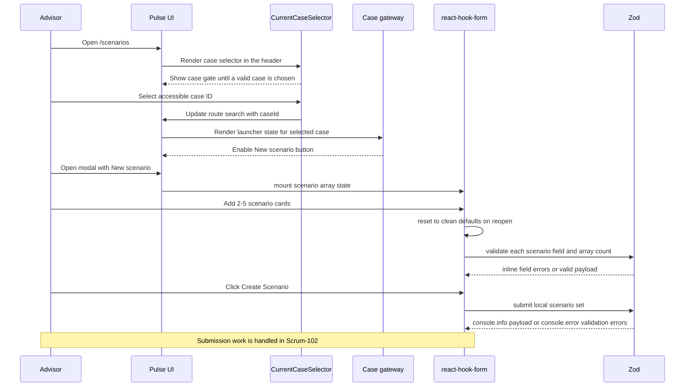
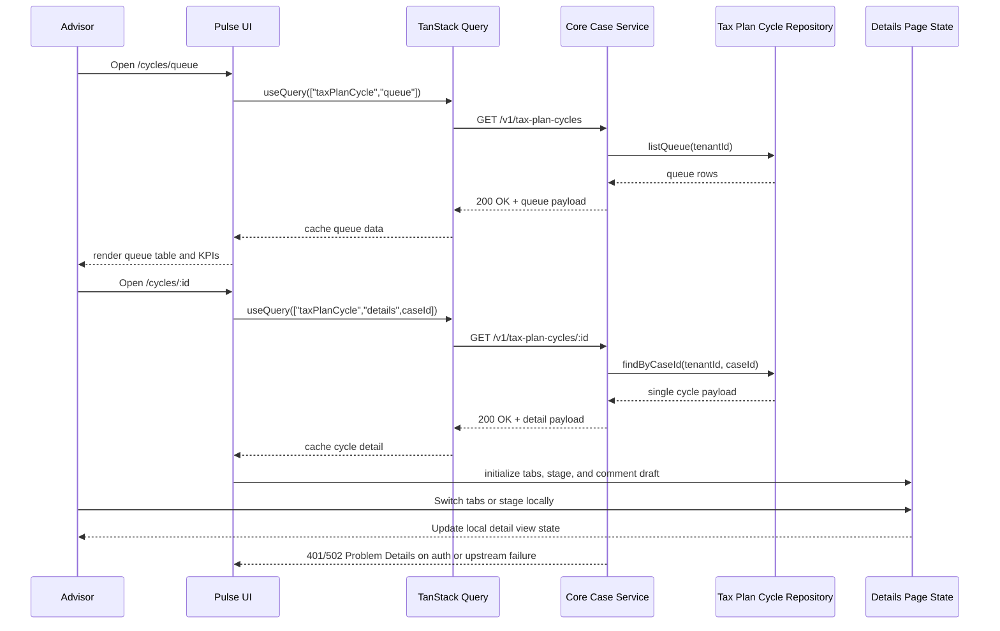
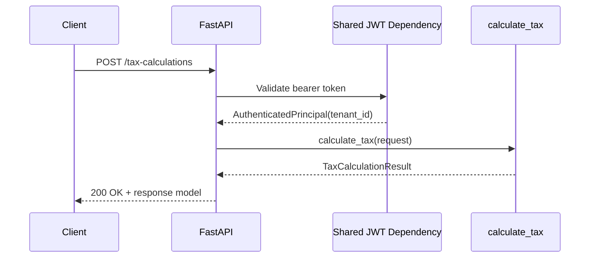
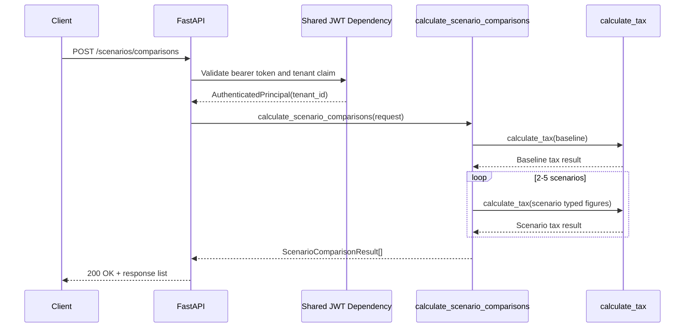
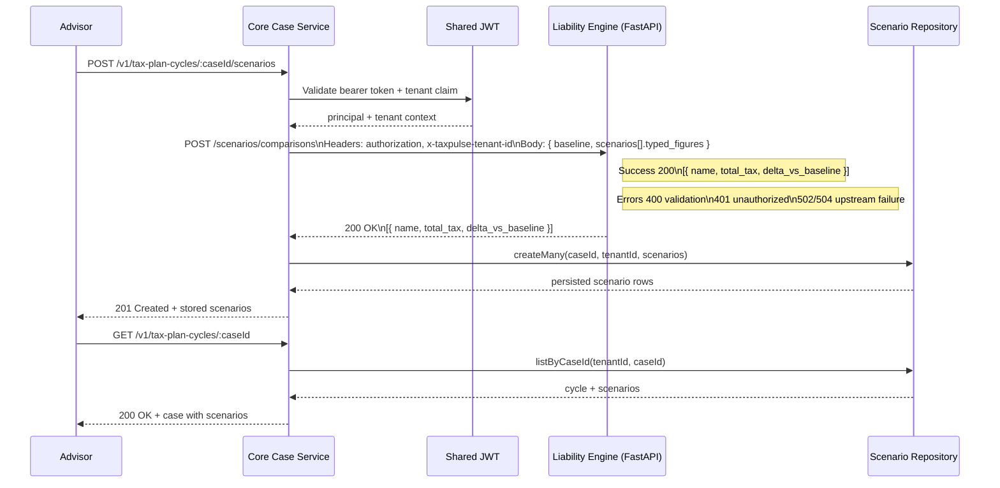
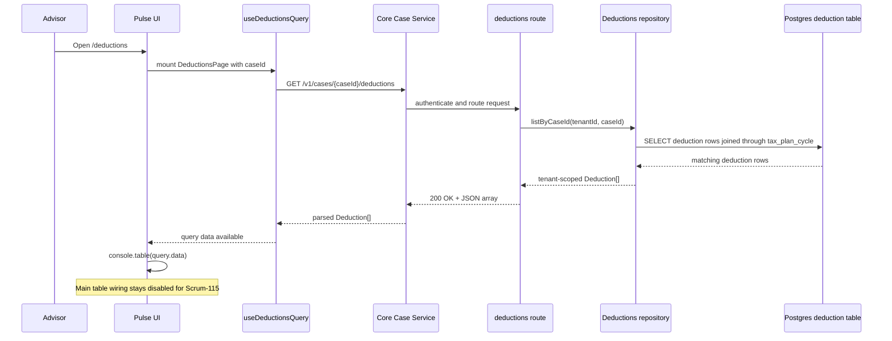
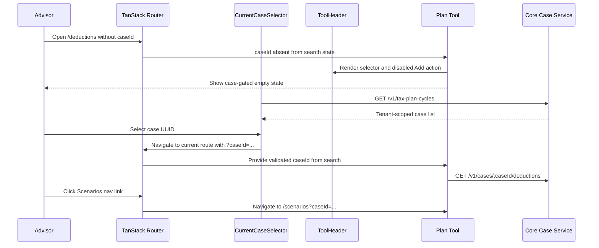

# Caleb Latimer Ticket Journal

**Owner:** Caleb Latimer  
**Branch prefix:** `caleb-latimer-`

Add new ticket entries below using this template.

<!--
## caleb-latimer-jiraXX - SCRUM-XX

**Branch:** `caleb-latimer-jiraXX`

**Assignee:** Caleb Latimer

**Jira Key:** SCRUM-XX

**Summary:**

**Description:**

**Acceptance Criteria:**

-

**Code Connection:**

**Project Scope Connection:**

**Changed Files:**

-

**Validation Notes:**

-
-->

## caleb-latimer-jira101 - SCRUM-101

**Branch:** `caleb-latimer-jira101`

**Assignee:** Caleb Latimer

**Jira Key:** SCRUM-101

**Summary:** Build the Scenario Planner form with react-hook-form + zod

**Description:** As an Advisor, I want a Scenario Planner form, so that I can enter a scenario inside a local modal on the Pulse UI `/scenarios` page.

**Acceptance Criteria:**

- The `/scenarios` page renders the `CurrentCaseSelector` in the tool header and uses the shared case gate when no valid case is selected.
- The launcher button is `New scenario` and stays disabled until a valid case is selected.
- The modal card title is `New What-If Scenario` and the body header is `New What if Scenario Set`.
- The form uses `react-hook-form` with Zod validation, logs validation failures to the console, and enforces the 2-5 scenario limit in the UI.
- The form UI stays on CSS modules rather than Tailwind utility styling.
- Successful submission logs locally with `console.info()` and keeps the Scrum-102 handoff comment in place.
- The page table area stays deferred to Jira-102.

**Sequence Diagram:**



**Code Connection:**

- `src/pulseUI/components/ScenarioForm.tsx`
- `src/pulseUI/components/CurrentCaseSelector.tsx`
- `src/pulseUI/components/scenario-form/Form.module.css`
- `src/pulseUI/components/scenario-form/Form.tsx`
- `src/pulseUI/components/scenario-form/ScenarioCard.tsx`
- `src/pulseUI/components/scenario-form/ScenarioCard.module.css`
- `src/pulseUI/components/scenario-form/StatusFooter.tsx`
- `src/pulseUI/components/scenario-form/StatusFooter.module.css`
- `src/pulseUI/components/scenario-form/constants.ts`
- `src/pulseUI/components/scenario-form/schema.ts`
- `src/pulseUI/components/PlanToolCaseGate.tsx`
- `src/pulseUI/pages/scenarios/ScenarioPlannerPage.tsx`
- `src/pulseUI/tests/scenarios/ScenarioPlannerPage.test.tsx`
- `src/pulseUI/tests/components/ScenarioForm.test.tsx`

**Project Scope Connection:**

- React SPA - Operator & Portal Experience
- Tax Plan Cycle scenario-planning UI work

**Form Structure / Validation Notes:**

- The form is a repeatable scenario array rendered inside a modal card.
- Each scenario requires name, description, income, deductions, and income type.
- The UI blocks submission until the scenario count is between 2 and 5.
- Inline errors render beside the offending field in each scenario card.
- The add-scenario control disables at 5 and the footer reflects the remaining slots.

**Income Type Mapping:**

```json
{
  "rt": "Rental",
  "cg": "Capital Gains",
  "se": "1099/Self-Employment",
  "w2": "W-2 Employment"
}
```

**Form Field Mapping:**

```json
{
  "scenarios": [
    {
      "scenarioName": "string",
      "description": "string",
      "additionalIncome": "number",
      "additionalDeductions": "number",
      "incomeType": "rt | cg | se | w2"
    }
  ]
}
```

**Changed Files:**

- `src/pulseUI/components/ScenarioForm.tsx`
- `src/pulseUI/components/CurrentCaseSelector.tsx`
- `src/pulseUI/components/scenario-form/Form.module.css`
- `src/pulseUI/components/scenario-form/Form.tsx`
- `src/pulseUI/components/scenario-form/ScenarioCard.tsx`
- `src/pulseUI/components/scenario-form/ScenarioCard.module.css`
- `src/pulseUI/components/scenario-form/StatusFooter.tsx`
- `src/pulseUI/components/scenario-form/StatusFooter.module.css`
- `src/pulseUI/components/scenario-form/constants.ts`
- `src/pulseUI/components/scenario-form/schema.ts`
- `src/pulseUI/pages/scenarios/ScenarioPlannerPage.tsx`
- `src/pulseUI/pages/scenarios/ScenarioPlannerPage.module.css`
- `src/pulseUI/tests/scenarios/ScenarioPlannerPage.test.tsx`
- `src/pulseUI/tests/components/ScenarioForm.test.tsx`
- `planning/team/cl-ticket-journal.md`

**Validation Notes:**

- Testing was intentionally deferred until implementation is complete and reviewed; typecheck is the only validation run so far.
- The updated form logs valid submissions with `console.info()` and validation failures with `console.error()`.
- The page now renders the `CurrentCaseSelector` in the tool header and shows the case gate when `caseId` is absent or invalid.
- The modal form no longer surfaces `caseId` in the UI or submission payload and starts clean on each reopen.
- Jira-102 owns the table fetch/post behavior and remains marked in the page area with a TODO comment.

**Additional Scope Impact (append-only):**

- The scenario modal styling was moved back to CSS modules after the utility-first pass, keeping the UI closer to the original component structure.
- The scenario form now renders a horizontal divider between repeated entries using the requested white-to-gray gradient treatment.
- The footer actions now read as a horizontal button group with icon affordances and primary/secondary/info emphasis.
- The form no longer receives or displays `caseId`; case injection remains reserved for Scrum-102 rollup behavior.
- Reopening the modal now starts from clean default state rather than preserving values or validation state from the previous open.
- The related page and test updates continue to reflect the case selector harness and the local-only submit flow.

## caleb-latimer-jira100 - SCRUM-100

**Branch:** `caleb-latimer-jira-100`

**Assignee:** Caleb Latimer

**Jira Key:** SCRUM-100

**Summary:** Jira-100 Wire the queue and detail screens to live data and consolidate detail navigation

**Description:** Wire the Tax Plan Cycle queue and detail screens to live server state using TanStack Query so the signed-in user's authorized cycles and cycle detail can be read through the Core service, then fold the legacy detail route/navigation state into `Details` and move query helpers into the entity layer.

**Acceptance Criteria:**

- The queue fetches the tenant's cycles via a TanStack Query hook.
- The detail screen fetches a single cycle by case ID.
- A scoped Advisor sees only their assigned cases per the permission matrix.
- The detail page owns its tab, stage, and comment draft state locally after the refactor.
- The legacy detail wrapper and navigation hook are deleted after the refactor.

**Sequence Diagram:**



**Code Connection:**

- `src/typescript/features/taxPlanCycle/routes.ts`
- `src/typescript/features/taxPlanCycle/taxPlanCycle.ts`
- `src/typescript/features/taxPlanCycle/repositories/repository.ts`
- `src/typescript/coreCaseOpenApi.ts`
- `src/pulseUI/app/bootstrap.tsx`
- `src/pulseUI/app/queryClient.ts`
- `src/pulseUI/shared/coreCaseApi.ts`
- `src/pulseUI/entities/taxPlanCycleQueries.ts`
- `src/pulseUI/pages/taxPlanCycle/PlanCycle.tsx`
- `src/pulseUI/pages/taxPlanCycle/Details.tsx`
- `src/pulseUI/pages/taxPlanCycle/Queue.tsx`
- `src/pulseUI/pages/taxPlanCycle/Details.module.css`
- `src/pulseUI/tests/taxPlanCycle/QueueState.test.tsx`
- `src/pulseUI/tests/taxPlanCycle/Queue.test.tsx`
- `src/pulseUI/tests/taxPlanCycle/Details.test.tsx`
- `src/pulseUI/tests/taxPlanCycle/queries.test.ts`
- `adr/0021-tanstack-query-for-pulse-ui-server-state.md`

**Project Scope Connection:**

- React SPA - Operator & Portal Experience
- Core Case Service tax plan cycle read wiring

**Changed Files:**

- `src/typescript/features/taxPlanCycle/routes.ts`
- `src/typescript/features/taxPlanCycle/taxPlanCycle.ts`
- `src/typescript/features/taxPlanCycle/repositories/repository.ts`
- `src/typescript/index.ts`
- `src/typescript/coreCaseOpenApi.ts`
- `tests/typescript/features/taxPlanCycle/mainComposition.test.ts`
- `tests/typescript/coreCaseOpenApi.test.ts`
- `src/pulseUI/package.json`
- `src/pulseUI/package-lock.json`
- `src/pulseUI/app/bootstrap.tsx`
- `src/pulseUI/app/queryClient.ts`
- `src/pulseUI/shared/coreCaseApi.ts`
- `src/pulseUI/pages/taxPlanCycle/PlanCycle.tsx`
- `src/pulseUI/pages/taxPlanCycle/Details.tsx`
- `src/pulseUI/pages/taxPlanCycle/Queue.tsx`
- `src/pulseUI/pages/taxPlanCycle/Details.module.css`
- `src/pulseUI/entities/taxPlanCycleQueries.ts`
- `src/pulseUI/pages/taxPlanCycle/PlanCycleDetailRoute.tsx`
- `src/pulseUI/pages/taxPlanCycle/queries.ts`
- `src/pulseUI/pages/taxPlanCycle/usePlanCycleDetailNavigation.ts`
- `src/pulseUI/tests/appShell.test.tsx`
- `src/pulseUI/tests/taxPlanCycle/QueueState.test.tsx`
- `src/pulseUI/tests/taxPlanCycle/Queue.test.tsx`

**Validation Notes:**

- `cmd /c "set PATH=C:\nvm4w\nodejs;%PATH% && npm.cmd --prefix src/pulseUI test -- tests/taxPlanCycle/Details.test.tsx tests/taxPlanCycle/queries.test.ts tests/taxPlanCycle/Queue.test.tsx tests/taxPlanCycle/QueueState.test.tsx"` passed.
- `cmd /c "set PATH=C:\nvm4w\nodejs;%PATH% && npm.cmd run typecheck"` passed.

**Assignee:** Caleb Latimer

**Jira Key:** SCRUM-100

**Summary:** Jira-100 Wire the queue and detail screens to live data and consolidate detail navigation

**Description:** Wire the Tax Plan Cycle queue and detail screens to live server state using TanStack Query so the signed-in user's authorized cycles and cycle detail can be read through the Core service, then fold the legacy detail route/navigation state into `Details` and move query helpers into the entity layer.

**Acceptance Criteria:**

- The queue fetches the tenant's cycles via a TanStack Query hook.
- The detail screen fetches a single cycle by case ID.
- A scoped Advisor sees only their assigned cases per the permission matrix.
- The detail page owns its tab, stage, and comment draft state locally after the refactor.
- The legacy detail wrapper and navigation hook are deleted after the refactor.

**Sequence Diagram:**


**Code Connection:**

- `src/typescript/features/taxPlanCycle/routes.ts`
- `src/typescript/features/taxPlanCycle/taxPlanCycle.ts`
- `src/typescript/features/taxPlanCycle/repositories/repository.ts`
- `src/typescript/coreCaseOpenApi.ts`
- `src/pulseUI/app/bootstrap.tsx`
- `src/pulseUI/app/queryClient.ts`
- `src/pulseUI/shared/coreCaseApi.ts`
- `src/pulseUI/entities/taxPlanCycleQueries.ts`
- `src/pulseUI/pages/taxPlanCycle/PlanCycle.tsx`
- `src/pulseUI/pages/taxPlanCycle/Details.tsx`
- `src/pulseUI/pages/taxPlanCycle/Queue.tsx`
- `src/pulseUI/pages/taxPlanCycle/Details.module.css`
- `src/pulseUI/tests/taxPlanCycle/QueueState.test.tsx`
- `src/pulseUI/tests/taxPlanCycle/Queue.test.tsx`
- `src/pulseUI/tests/taxPlanCycle/Details.test.tsx`
- `src/pulseUI/tests/taxPlanCycle/queries.test.ts`
- `adr/0021-tanstack-query-for-pulse-ui-server-state.md`

**Project Scope Connection:**

- React SPA - Operator & Portal Experience
- Core Case Service tax plan cycle read wiring

**Changed Files:**

- `src/typescript/features/taxPlanCycle/routes.ts`
- `src/typescript/features/taxPlanCycle/taxPlanCycle.ts`
- `src/typescript/features/taxPlanCycle/repositories/repository.ts`
- `src/typescript/index.ts`
- `src/typescript/coreCaseOpenApi.ts`
- `tests/typescript/features/taxPlanCycle/mainComposition.test.ts`
- `tests/typescript/coreCaseOpenApi.test.ts`
- `src/pulseUI/package.json`
- `src/pulseUI/package-lock.json`
- `src/pulseUI/app/bootstrap.tsx`
- `src/pulseUI/app/queryClient.ts`
- `src/pulseUI/shared/coreCaseApi.ts`
- `src/pulseUI/pages/taxPlanCycle/PlanCycle.tsx`
- `src/pulseUI/pages/taxPlanCycle/Details.tsx`
- `src/pulseUI/pages/taxPlanCycle/Queue.tsx`
- `src/pulseUI/pages/taxPlanCycle/Details.module.css`
- `src/pulseUI/entities/taxPlanCycleQueries.ts`
- `src/pulseUI/pages/taxPlanCycle/PlanCycleDetailRoute.tsx`
- `src/pulseUI/pages/taxPlanCycle/queries.ts`
- `src/pulseUI/pages/taxPlanCycle/usePlanCycleDetailNavigation.ts`
- `src/pulseUI/tests/appShell.test.tsx`
- `src/pulseUI/tests/taxPlanCycle/QueueState.test.tsx`
- `src/pulseUI/tests/taxPlanCycle/Queue.test.tsx`
- `src/pulseUI/tests/taxPlanCycle/Details.test.tsx`
- `src/pulseUI/tests/taxPlanCycle/queries.test.ts`
- `src/pulseUI/tests/planCycleDetailNavigation.test.tsx`
- `src/pulseUI/tests/planCycleDetailRoute.test.tsx`
- `adr/0021-tanstack-query-for-pulse-ui-server-state.md`
- `adr/README.md`
- `planning/team/cl-ticket-journal.md`

**Validation Notes:**

- `cmd /c "set PATH=C:\\nvm4w\\nodejs;%PATH% && npm.cmd run typecheck"` passed at the repo root.
- `cmd /c "set PATH=C:\\nvm4w\\nodejs;%PATH% && npm.cmd test"` passed in `src/pulseUI`.
- `cmd /c "set PATH=C:\\nvm4w\\nodejs;%PATH% && npm.cmd test"` at the repo root failed in the integration suite because Testcontainers could not find a working container runtime strategy in this environment.
- The queue-state test harness now uses router context so the success branch no longer emits a `useRouter must be used inside a <RouterProvider>` warning.
- `cmd /c "set PATH=C:\\nvm4w\\nodejs;%PATH% && npm.cmd --prefix src/pulseUI test -- tests/taxPlanCycle/Details.test.tsx tests/taxPlanCycle/queries.test.ts tests/taxPlanCycle/Queue.test.tsx tests/taxPlanCycle/QueueState.test.tsx"` passed.
- `cmd /c "set PATH=C:\\nvm4w\\nodejs;%PATH% && npm.cmd --prefix src/pulseUI run typecheck"` passed.

## caleb-latimer-jira93 - SCRUM-93

**Branch:** `caleb-latimer-jira93`

**Assignee:** Caleb Latimer

**Jira Key:** SCRUM-93

**Summary:** Jira-93 UI Feedback Pass

**Description:** Tighten the Tax Plan Cycle queue screen so the topbar, KPI copy, table layout, document chrome, and details placeholder match the current mockup and route structure.

**Acceptance Criteria:**

- The queue renders at `/cycles/queue` with rows for case ID, client, stage, owner, priority, due date, updated date, and action.
- Cases past their due date render an Overdue badge in place of the due-date text.
- The queue KPI cards render with the updated copy and the topbar includes the grouped role selector, live calculation indicator, and settings modal trigger.
- A blank details route exists at `/cycles/:id` and the `Open` action routes there.

**Code Connection:**

- `src/pulseUI/app/bootstrap.tsx`
- `src/pulseUI/app/createPulseRouter.ts`
- `src/pulseUI/app/routeTree.tsx`
- `src/pulseUI/components/AppShell.tsx`
- `src/pulseUI/entities/taxPlanCycle.ts`
- `src/pulseUI/pages/taxPlanCycle/PlanCycle.tsx`
- `src/pulseUI/pages/taxPlanCycle/Queue.tsx`
- `src/pulseUI/pages/taxPlanCycle/Details.tsx`
- `src/pulseUI/shared/navigation.ts`
- `src/pulseUI/shared/viewTitle.ts`
- `src/pulseUI/shared/styles.css`
- `src/pulseUI/styles.css` (removed)
- `src/pulseUI/vite.config.ts`
- `src/pulseUI/index.html`
- `src/pulseUI/public/calculator-favicon.svg`
- `src/pulseUI/tests/taxPlanCycle/Queue.test.tsx`
- `src/pulseUI/tests/taxPlanCycle/Details.test.tsx`
- `src/pulseUI/main.tsx`
- `adr/0019-tailwind-styling-foundation-for-pulse-ui.md`
- `adr/0020-pulse-ui-layered-application-structure.md`

**Project Scope Connection:**

- React SPA - Operator & Portal Experience
- Tax Plan Cycle queue UI work

**Changed Files:**

- `src/pulseUI/app/bootstrap.tsx`
- `src/pulseUI/app/createPulseRouter.ts`
- `src/pulseUI/app/routeTree.tsx`
- `src/pulseUI/components/AppShell.tsx`
- `src/pulseUI/entities/taxPlanCycle.ts`
- `src/pulseUI/pages/EmptyPage.tsx`
- `src/pulseUI/pages/taxPlanCycle/PlanCycle.tsx`
- `src/pulseUI/pages/taxPlanCycle/Queue.tsx`
- `src/pulseUI/pages/taxPlanCycle/Details.tsx`
- `src/pulseUI/shared/navigation.ts`
- `src/pulseUI/shared/viewTitle.ts`
- `src/pulseUI/shared/styles.css`
- `src/pulseUI/vite.config.ts`
- `src/pulseUI/tests/appShell.test.tsx`
- `src/pulseUI/tests/taxPlanCycle/QueueState.test.tsx`
- `src/pulseUI/tests/taxPlanCycle/Queue.test.tsx`
- `src/pulseUI/tests/taxPlanCycle/Details.test.tsx`
- `src/pulseUI/main.tsx`
- `src/pulseUI/index.html`
- `src/pulseUI/package.json`
- `src/pulseUI/package-lock.json`
- `src/pulseUI/public/calculator-favicon.svg`
- `adr/0019-tailwind-styling-foundation-for-pulse-ui.md`
- `adr/0020-pulse-ui-layered-application-structure.md`
- `adr/README.md`
- `planning/team/cl-ticket-journal.md`

**Validation Notes:**

- `cmd /c "set PATH=C:\\nvm4w\\nodejs;%PATH% && npm.cmd run typecheck"` passed in `src/pulseUI`.
- `cmd /c "set PATH=C:\\nvm4w\\nodejs;%PATH% && npm.cmd test"` passed in `src/pulseUI`.
- Final manual step after tests: compare the rendered queue page against the mocked layout referenced in `AGENTS.md` and note any pixel-level gaps before closing the ticket.

## caleb-latimer-jira74 - SCRUM-74

**Branch:** `caleb-latimer-jira74`

**Assignee:** Caleb Latimer

**Jira Key:** SCRUM-74

**Summary:** Project Tax Plan Cycle changes into the queue table

**Description:** As a Backend Developer, I want cycle changes projected into the DynamoDB queue, so that the read model stays consistent with the case.

**Acceptance Criteria:**

- Creating or updating a cycle upserts its queue projection item.
- The queue projection item uses the tenant/case key contract and preserves the projected case fields.
- The LocalStack-backed queue table can be created and queried in tests.
- The Python queue-projection tests pass with the repository validation flow.

**Code Connection:**

- `src/tax_liability_engine/tax_plan_cycle_queue_projection.py`
- `src/tax_liability_engine/dynamodb/plan_cycle_queue_projection.py`
- `tests/tax_liability_engine/tax_plan_cycle_queue_projection/test_service.py`
- `tests/tax_liability_engine/test_plan_cycle_queue_projection.py`

**Project Scope Connection:**

- Polyglot Backend & Contracts
- Tax Plan Cycle queue projection read-model work

**Changed Files:**

- `src/tax_liability_engine/`
- `tests/tax_liability_engine/`
- `README.md`
- `CONTRIBUTING.md`
- `setup.sh`
- `pyproject.toml`
- `adr/0013-tax-liability-engine-namespace-refactor.md`

**Validation Notes:**

- `.\.venv\Scripts\python.exe -m pytest --cache-clear`
- `.\.venv\Scripts\python.exe -m pytest --basetemp=.pytest-tmp`
- `python -m pytest --cache-clear` in PowerShell also passed after the dev environment was installed
- LocalStack integration tests are wired through testcontainers and skip when Docker is not reachable in the current shell

## caleb-latimer-jira75 - SCRUM-75

**Branch:** `caleb-latimer-jira75`

**Assignee:** Caleb Latimer

**Jira Key:** SCRUM-75

**Summary:** Cache the queue read in Redis with invalidation

**Description:** As an Advisor, I want the Plan Cycle Queue cached in Redis, so that the queue loads fast without hammering the read store.

**Acceptance Criteria:**

- Queue reads check Redis first and fall back to DynamoDB on a miss.
- A cache entry is invalidated when a case's stage or due_date changes.
- A test asserts a stale entry is not served after an invalidating change.

**Code Connection:**

- `src/typescript/taxPlanCycleQueueProjection.ts`
- `src/typescript/taxPlanCycleQueueCache.ts`
- `src/typescript/taxPlanCycleQueueDynamoStore.ts`
- `src/typescript/taxPlanCycleQueueReadService.ts`
- `src/typescript/taxPlanCycleTransitionController.ts`
- `tests/typescript/bootstrap/dockerRedis.ts`
- `tests/typescript/taxPlanCycleQueueCache.test.ts`
- `tests/typescript/taxPlanCycleQueueDynamoStore.test.ts`
- `tests/typescript/taxPlanCycleQueueRead.integration.ts`

**Project Scope Connection:**

- Polyglot Backend & Contracts
- Core Case Service queue-read cache-aside work

**Changed Files:**

- `src/typescript/`
- `tests/typescript/`
- `README.md`
- `.env.example`
- `package.json`
- `adr/0014-redis-cache-aside-queue-reads.md`
- `adr/README.md`

**Validation Notes:**

- Scaffolding was completed in the sandbox, but the new npm dependencies still need to be installed locally before `npm run typecheck`, `npm test`, and `npm run test:integration` can be executed.
- New queue-cache tests were added under the Tax Plan Cycle feature slice so the Redis coverage can be run directly with Vitest after install.
## caleb-latimer-jira84 - SCRUM-84

**Branch:** `caleb-latimer-jira84`

**Assignee:** Caleb Latimer

**Jira Key:** SCRUM-84

**Summary:** Expose the tax calculation via a FastAPI endpoint

**Description:** As an Advisor, I want the calculation exposed via a JWT-protected
FastAPI endpoint, so that the Core service can request real numbers.

**Acceptance Criteria:**

- A POST endpoint accepts the calculation request and returns the response model.
- The endpoint requires a valid shared JWT and is tenant-scoped.
- An httpx test asserts a sample request returns the expected liability.

**Sequence Diagram:**



**Code Connection:** `src/python/tax_pulse_project_team_1/app.py` now owns the FastAPI
composition root, `src/python/tax_pulse_project_team_1/api.py` keeps the compatibility
import surface, and the `/tax-calculations` route lives in the feature slice under
`src/python/tax_pulse_project_team_1/routers/tax_calculation.py`. The new HTTP test
exercises the ASGI app through `httpx` and verifies the response model and liability
output.

**Project Scope Connection:** This delivers the Polyglot Backend & Contracts ticket by
exposing the Python tax engine as the tenant-scoped service endpoint the Core service
can call without changing the calculation math contract or introducing persistence.

**Changed Files:**

- `src/python/tax_pulse_project_team_1/api.py`
- `src/python/tax_pulse_project_team_1/app.py`
- `src/python/tax_pulse_project_team_1/dependencies.py`
- `src/python/tax_pulse_project_team_1/routers/__init__.py`
- `src/python/tax_pulse_project_team_1/routers/health.py`
- `src/python/tax_pulse_project_team_1/routers/tax_calculation.py`
- `src/python/tax_pulse_project_team_1/routers/scenario_comparison.py`
- `src/python/tax_pulse_project_team_1/jwt_authentication.py`
- `src/python/tax_pulse_project_team_1/__init__.py`
- `tests/python/test_tax_calculation.py`
- `tests/python/test_tax_calculation_api.py`
- `tests/python/test_plan_cycle_queue_projection.py`
- `src/tax_liability_engine/scripts/liability_engine_on.py`
- `adr/0016-fastapi-startup-convention.md`
- `docs/postman/jira84-tax-calculation.postman_collection.json`
- `docs/postman/jira84-tax-calculation.postman_environment.json`
- `README.md`
- `pyproject.toml`

**Validation Notes:**

- `.\.venv\Scripts\python.exe -m ruff format --check src/python tests/python` passed.
- `.\.venv\Scripts\python.exe -m pyright --pythonpath .\.venv\Scripts\python.exe`
  passed.
- `.\.venv\Scripts\python.exe -m pytest tests/python/test_tax_calculation_api.py
  tests/python/test_scenario_comparison_api.py` passed: 11 tests passed.
- `python src/tax_liability_engine/scripts/liability_engine_on.py` launched the API and returned
  `{"status":"ok"}` from `GET /health`.
- `.\.venv\Scripts\python.exe -m pytest` passed: 74 tests passed, 2 skipped.

## caleb-latimer-jira87 - SCRUM-87

**Branch:** `caleb-latimer-jira87`

**Assignee:** Caleb Latimer

**Jira Key:** SCRUM-87

**Summary:** Expose the scenario comparison HTTP endpoint

**Description:** As an Advisor, I want a scenario endpoint, so that scenario
comparisons can be requested over HTTP.

**Acceptance Criteria:**

- A POST endpoint accepts a baseline plus 2-5 scenarios and returns each scenario's
  total tax and delta.
- The endpoint enforces the 2-5 bound and returns 422 otherwise.
- An httpx test asserts a 3-scenario request returns three deltas.

**Sequence Diagram:**



**Code Connection:** `src/python/tax_pulse_project_team_1/app.py` now composes the
FastAPI application, `src/python/tax_pulse_project_team_1/api.py` preserves the public
import surface, and the tenant-scoped `/scenarios/comparisons` route lives in
`src/python/tax_pulse_project_team_1/routers/scenario_comparison.py`. The slice
reuses the shared JWT dependency pattern from Jira-84 and delegates all math to
`calculate_scenario_comparisons` without wrapping or altering the result model.

**Project Scope Connection:** This delivers the transport layer for the scenario
comparison contract that Jira-86 introduced in the Python service. It stays within the
Polyglot Backend & Contracts workstream, does not add persistence, and preserves the
existing calculation math contract.

**Changed Files:**

- `src/python/tax_pulse_project_team_1/api.py`
- `src/python/tax_pulse_project_team_1/app.py`
- `src/python/tax_pulse_project_team_1/dependencies.py`
- `src/python/tax_pulse_project_team_1/routers/__init__.py`
- `src/python/tax_pulse_project_team_1/routers/health.py`
- `src/python/tax_pulse_project_team_1/routers/tax_calculation.py`
- `src/python/tax_pulse_project_team_1/routers/scenario_comparison.py`
- `tests/python/test_tax_calculation_api.py`
- `tests/python/test_scenario_comparison_api.py`
- `planning/team/cl-ticket-journal.md`
- `planning/prompt-journal/cl-journal.md`

**Validation Notes:**

- `.\.venv\Scripts\python.exe -m ruff format --check src/python tests/python` passed.
- `.\.venv\Scripts\python.exe -m pyright --pythonpath .\.venv\Scripts\python.exe`
  passed with 0 errors and 0 warnings.
- `.\.venv\Scripts\python.exe -m pytest tests/python/test_tax_calculation_api.py
  tests/python/test_scenario_comparison_api.py` passed: 11 tests passed.
- `.\.venv\Scripts\python.exe -m pytest` passed: 74 tests passed, 2 skipped.

## caleb-latimer-jira90 - SCRUM-90

**Branch:** `caleb-latimer-jira90`

**Assignee:** Caleb Latimer

**Jira Key:** SCRUM-90

**Summary:** Call the Tax Engine from Core through the Node HTTP client and persist modeled scenario results

**Description:** As an Advisor, I want modeling on a cycle to call the Tax Engine through the Core service, so that results are persisted on the case.

**Acceptance Criteria:**

- A scenario-modeling request on a case in Modeling stage calls the engine using the Node service's native HTTP client with a per-call timeout and bounded retries, and stores the returned figures.
- The call carries the shared JWT and tenant context.
- The stored scenario results are returned on a subsequent case read.

**Sequence Diagram:**



**Code Connection:** `src/typescript/features/taxPlanCycle/routes.ts` now exposes the modeling POST and read-back flow, `src/typescript/features/taxPlanCycle/controllers/scenarios.ts` owns the engine call and persistence handoff, `src/typescript/features/taxPlanCycle/infrastructure/engineClient.ts` provides the native HTTP client with timeout and retry handling, `src/typescript/features/taxPlanCycle/repositories/scenarios.ts` stores and lists scenario rows, and `src/typescript/coreCaseOpenApi.ts` documents the scenario request and response shapes. `src/typescript/index.ts` wires the runtime composition and exports the feature-local scenario contracts.

**Project Scope Connection:** This sits in the Polyglot Backend & Contracts workstream and extends the Core Case Service scenario-modeling slice so the TypeScript service can broker engine calls and persist the modeled figures without changing the tax math contract itself.

**Changed Files:**

- `src/typescript/features/taxPlanCycle/routes.ts`
- `src/typescript/features/taxPlanCycle/scenarioModelingController.ts`
- `src/typescript/scenarioModeling.ts`
- `src/typescript/taxEngineClient.ts`
- `src/typescript/scenarioRepository.ts`
- `src/typescript/coreCaseOpenApi.ts`
- `src/typescript/features/taxPlanCycle/taxPlanCycle.ts`
- `src/typescript/index.ts`
- `tests/typescript/features/taxPlanCycle/routes.test.ts`
- `tests/typescript/features/taxPlanCycle/mainComposition.test.ts`
- `.env.example`
- `README.md`
- `planning/team/cl-ticket-journal.md`
- `planning/prompt-journal/cl-journal.md`

**Validation Notes:**

- `cmd /c "set PATH=C:\nvm4w\nodejs;%PATH% && npm.cmd run typecheck"` passed.
- `cmd /c "set PATH=C:\nvm4w\nodejs;%PATH% && npm.cmd test"` passed: 45 test files passed, 1 skipped; 201 tests passed, 1 skipped.

## caleb-latimer-jira91 - SCRUM-91

**Branch:** `caleb-latimer-jira91`

**Assignee:** Caleb Latimer

**Jira Key:** SCRUM-91

**Summary:** Surface liability-engine failures as 502 Problem Details without mutating scenario state

**Description:** As an Advisor, I want engine failures surfaced cleanly, so that a calculation outage never corrupts a case.

**Acceptance Criteria:**

- An engine failure surfaces as a 502-class Problem Details error.
- The case's stored state is unchanged after a failed call.
- A test asserts the case is intact after an injected engine failure.

**Code Connection:** `src/typescript/features/taxPlanCycle/controllers/scenarios.ts` now translates scenario-modeling engine failures into `ProblemHttpError` 502 responses without a feature-local scenario logger, `src/typescript/features/taxPlanCycle/routes.ts` continues to delegate scenario modeling through the feature-local controller, `src/typescript/coreCaseOpenApi.ts` documents the 502 scenario failure response, and `src/typescript/index.ts` wires the tax plan cycle feature through the composition root.

**Project Scope Connection:** This extends the Core Case Service scenario-modeling slice from Jira-90 and keeps the FastAPI liability engine wire contract unchanged while tightening the Core-side failure boundary.

**Changed Files:**

- `src/typescript/features/taxPlanCycle/controllers/scenarios.ts`
- `src/typescript/coreCaseOpenApi.ts`
- `src/typescript/index.ts`
- `tests/typescript/features/taxPlanCycle/scenarios.test.ts`
- `tests/typescript/features/taxPlanCycle/routes.test.ts`
- `src/typescript/features/taxPlanCycle/repositories/repository.ts`
- `src/typescript/features/taxPlanCycle/repository/repository.ts`
- `src/typescript/features/taxPlanCycle/readService.ts`
- `src/typescript/features/taxPlanCycle/infrastructure/queueDynamoStore.ts`
- `src/typescript/features/taxPlanCycle/controllers/createController.ts`
- `src/typescript/features/taxPlanCycle/controllers/transitionController.ts`
- `src/typescript/features/taxPlanCycle/index.ts`
- `tests/typescript/features/taxPlanCycle/mainComposition.test.ts`
- `package.json`
- `vitest.config.ts`
- `planning/team/cl-ticket-journal.md`

**Validation Notes:**

- `cmd /c "set PATH=C:\nvm4w\nodejs;%PATH% && npm.cmd run typecheck"` passed.
- `cmd /c "set PATH=C:\nvm4w\nodejs;%PATH% && npm.cmd test"` passed after fixing the stale `test:express` script reference and scoping Vitest away from the React UI tree.
- Deviation from the original change set: the scenario-local logger was removed entirely because it did not improve the failure output enough to justify the added scope.
- Deviation from the original change set: the root test harness was repaired as part of the same pass so the Node test run is exclusive from the React UI tree and `npm test` is meaningful again.

## caleb-latimer-jira111 - SCRUM-111

**Branch:** `caleb-latimer-jira111`

**Assignee:** Caleb Latimer

**Jira Key:** SCRUM-111

**Summary:** Scaffold the Deductions & Expenses screen component from the wireframe and refine shell navigation

**Description:** Scaffold a typed Pulse UI `/deductions` screen with a reusable tool header, KPI region, and table region, then update the shell navigation and sidebar footer copy so the layout is stable before data wiring lands.

**Acceptance Criteria:**

- The `/deductions` route renders a typed deductions screen scaffold instead of the empty page.
- The screen uses reusable shared UI where it already exists, especially `MetricCard`.
- The screen includes a local placeholder modal shell opened by the Add Deduction button.
- The screen stays fully local and inert with no data fetching or backend changes.
- The sidebar includes an Administration section plus a footer user card and Logout button.
- The deductions nav entry uses the percent icon and the title copy reads `Deductions & Expenses`.

**Code Connection:**

- `src/pulseUI/components/ToolHeader.tsx`
- `src/pulseUI/components/DataTable.tsx`
- `src/pulseUI/pages/deductions/DeductionsPage.tsx`
- `src/pulseUI/pages/deductions/DeductionsPage.module.css`
- `src/pulseUI/components/AppShell.tsx`
- `src/pulseUI/components/AppShell.module.css`
- `src/pulseUI/shared/navigation.ts`
- `src/pulseUI/app/routeTree.tsx`
- `src/pulseUI/tests/components/ToolHeader.test.tsx`
- `src/pulseUI/tests/components/DataTable.test.tsx`
- `src/pulseUI/tests/deductions/DeductionsPage.test.tsx`
- `src/pulseUI/tests/appShell.test.tsx`

**Project Scope Connection:**

- React SPA - Operator & Portal Experience
- Plan tools screen scaffolding

**Changed Files:**

- `src/pulseUI/components/ToolHeader.tsx`
- `src/pulseUI/components/ToolHeader.module.css`
- `src/pulseUI/components/DataTable.tsx`
- `src/pulseUI/components/DataTable.module.css`
- `src/pulseUI/pages/deductions/DeductionsPage.tsx`
- `src/pulseUI/pages/deductions/DeductionsPage.module.css`
- `src/pulseUI/components/AppShell.tsx`
- `src/pulseUI/components/AppShell.module.css`
- `src/pulseUI/shared/navigation.ts`
- `src/pulseUI/app/routeTree.tsx`
- `src/pulseUI/tests/components/ToolHeader.test.tsx`
- `src/pulseUI/tests/components/DataTable.test.tsx`
- `src/pulseUI/tests/deductions/DeductionsPage.test.tsx`
- `src/pulseUI/tests/appShell.test.tsx`
- `planning/team/cl-ticket-journal.md`

**Validation Notes:**

- `cmd /c "set PATH=C:\nvm4w\nodejs;%PATH% && npm.cmd run typecheck"` passed.
- `cmd /c "set PATH=C:\nvm4w\nodejs;%PATH% && npm.cmd --prefix src/pulseUI test -- tests/components/ToolHeader.test.tsx tests/components/DataTable.test.tsx tests/deductions/DeductionsPage.test.tsx"` passed.
- `cmd /c "set PATH=C:\nvm4w\nodejs;%PATH% && npm.cmd --prefix src/pulseUI test -- tests/appShell.test.tsx tests/components/ToolHeader.test.tsx tests/components/DataTable.test.tsx tests/deductions/DeductionsPage.test.tsx"` passed.

## caleb-latimer-jira112 - SCRUM-112

**Branch:** `caleb-latimer-jira112`

**Assignee:** Caleb Latimer

**Jira Key:** SCRUM-112

**Summary:** Replace deductions GET mocks with a Postgres-backed list endpoint and align the Pulse UI query consumer to integration a TanStack Query hook to the deductions endpoint

**Description:** As a Core Case Service engineer, I want `GET /v1/cases/:caseId/deductions` to read directly from Postgres and return a JSON array of deduction rows, so that the Deductions screen can consume tenant-scoped live data through a typed query boundary instead of a synthetic aggregation payload.

**Acceptance Criteria:**

- `GET /v1/cases/:caseId/deductions` queries the `deduction` table directly.
- The repository filters by the authenticated tenant and requested case.
- The endpoint returns a JSON array of deduction rows with ISO date strings and numeric fields serialized for JSON transport.
- The deductions backend no longer depends on the in-memory aggregation mock, controller stub, or 404 placeholder path.
- The Pulse UI query layer treats the response as `Deduction[]`, and the Deductions page logs the parsed array with `console.table()`.
- Repository, route, and UI regression tests cover the owning tenant, cross-tenant access, empty-list cases, and the parsed response shape.
- The OpenAPI contract reflects the new list response.

**Sequence Diagram:**



**Code Connection:**

- `src/typescript/features/deductions/repositories/repository.ts`
- `src/typescript/features/deductions/repositories/deduction.ts`
- `src/typescript/features/deductions/routes.ts`
- `src/typescript/features/deductions/controllers/deductions.ts`
- `src/typescript/features/deductions/repositories/mockAggregationDataSource.ts`
- `src/typescript/coreCaseOpenApi.ts`
- `src/typescript/index.ts`
- `src/typescript/shared/database/seed.model.ts`
- `src/pulseUI/entities/deductionQueries.ts`
- `src/pulseUI/pages/deductions/DeductionsPage.tsx`
- `src/pulseUI/tests/entities/deductionQueries.test.ts`
- `src/pulseUI/tests/deductions/DeductionsPage.test.tsx`
- `tests/typescript/features/deductions/repository.test.ts`
- `tests/typescript/features/deductions/routes.test.ts`
- `tests/typescript/deductionAggregationClient.test.ts`

**Project Scope Connection:**

- Core Case Service backend
- Tenant-scoped read path and API contract cleanup
- Pulse UI deductions query boundary alignment

**Changed Files:**

- `src/typescript/features/deductions/repositories/repository.ts`
- `src/typescript/features/deductions/repositories/deduction.ts`
- `src/typescript/features/deductions/routes.ts`
- `src/typescript/features/deductions/controllers/deductions.ts`
- `src/typescript/features/deductions/repositories/mockAggregationDataSource.ts`
- `src/typescript/coreCaseOpenApi.ts`
- `src/typescript/index.ts`
- `src/typescript/shared/database/seed.model.ts`
- `src/pulseUI/entities/deductionQueries.ts`
- `src/pulseUI/pages/deductions/DeductionsPage.tsx`
- `src/pulseUI/tests/entities/deductionQueries.test.ts`
- `src/pulseUI/tests/deductions/DeductionsPage.test.tsx`
- `tests/typescript/features/deductions/repository.test.ts`
- `tests/typescript/features/deductions/routes.test.ts`
- `tests/typescript/deductionAggregationClient.test.ts`
- `planning/team/cl-ticket-journal.md`

**Validation Notes:**

- `cmd /c "set PATH=C:\nvm4w\nodejs;%PATH% && npm.cmd run typecheck"` passed.
- `cmd /c "set PATH=C:\nvm4w\nodejs;%PATH% && npm.cmd test"` still fails in this host because the existing suite depends on Docker/Testcontainers integration and one pre-existing `jwtProtectedRoutes` assertion mismatch remains outside this change.

## caleb-latimer-jira117 - SCRUM-117

**Branch:** `caleb-latimer-jira117`

**Assignee:** Caleb Latimer

**Jira Key:** SCRUM-117

**Summary:** Scaffold the Quarterly Payments screen component from the wireframe

**Description:** As an Advisor, I want a read-only Quarterly Payments screen, so that I can review the estimated installment schedule and withholding coverage before charting and payment actions are added later.

**Acceptance Criteria:**

- The `/quarterly-payments` route renders a typed quarterly payments screen instead of the empty page.
- The screen shows a KPI region with the second card styled green and the last card styled amber.
- The screen shows a read-only quarter timeline with exactly seven seeded estimate items.
- The screen includes a withholding progress placeholder card with `TBD` content.
- The screen does not scaffold payment recording or mark-paid actions.

**Code Connection:**

- `src/pulseUI/pages/quarterlyPayments/QuarterlyPaymentsPage.tsx`
- `src/pulseUI/pages/quarterlyPayments/QuarterlyPaymentsPage.module.css`
- `src/pulseUI/components/QuarterlyTimelineItem.tsx`
- `src/pulseUI/components/QuarterlyTimelineItem.module.css`
- `src/pulseUI/app/routeTree.tsx`
- `src/pulseUI/tests/quarterlyPayments/QuarterlyPaymentsPage.test.tsx`

**Project Scope Connection:**

- React SPA - Operator & Portal Experience
- Plan tools screen scaffolding

**Changed Files:**

- `src/pulseUI/components/QuarterlyTimelineItem.tsx`
- `src/pulseUI/components/QuarterlyTimelineItem.module.css`
- `src/pulseUI/pages/quarterlyPayments/QuarterlyPaymentsPage.tsx`
- `src/pulseUI/pages/quarterlyPayments/QuarterlyPaymentsPage.module.css`
- `src/pulseUI/app/routeTree.tsx`
- `src/pulseUI/tests/quarterlyPayments/QuarterlyPaymentsPage.test.tsx`
- `planning/team/cl-ticket-journal.md`

**Validation Notes:**

- `cmd /c "set PATH=C:\nvm4w\nodejs;%PATH% && npx tsc --noEmit"` passed.
- `cmd /c "set PATH=C:\nvm4w\nodejs;%PATH% && npm.cmd --prefix src/pulseUI test -- tests/quarterlyPayments/QuarterlyPaymentsPage.test.tsx tests/appShell.test.tsx tests/components/ToolHeader.test.tsx tests/components/DataTable.test.tsx"` passed.

## caleb-latimer-jira203 - SCRUM-203

**Branch:** `caleb-latimer-jira203`

**Assignee:** Caleb Latimer

**Jira Key:** SCRUM-203

**Summary:** Add route-driven case selection for plan tools

**Description:** Plan tools require a Tax Plan Cycle primary key before they can fetch or change case data. This slice introduces a TanStack Router search-param case gate so Deductions, Scenarios, Quarterly Payments, and the visible Income placeholder can independently initialize and consume the selected case ID.

**Acceptance Criteria:**

- Planning tool routes accept an optional UUID-shaped `caseId` search parameter.
- Missing or invalid case IDs render a shared selector gate and prevent native page fetch/post behavior.
- Any planning tool can initialize selection through `GET /v1/tax-plan-cycles`.
- Plan-tool nav links preserve selected `caseId`; unrelated nav links do not.
- Toolbar form actions are disabled until a valid case ID exists.
- ADR-0026 records the route-driven case context decision.

**Sequence Diagram:**



**Code Connection:**

- Pulse UI routing and sidebar navigation
- Shared plan-tool case selector and route-search helpers
- Deductions, Scenarios, Quarterly Payments, and Income plan-tool gates
- ADR and local environment configuration

**Project Scope Connection:**

- React SPA - Operator & Portal Experience
- Tenant-scoped Tax Plan Cycle workflow
- Case-bound plan tools and server-state fetching

**Changed Files:**

- `src/pulseUI/app/routeTree.tsx`
- `src/pulseUI/components/AppShell.tsx`
- `src/pulseUI/components/ToolHeader.tsx`
- `src/pulseUI/components/CurrentCaseSelector.tsx`
- `src/pulseUI/components/PlanToolCaseGate.tsx`
- `src/pulseUI/shared/planToolCase.ts`
- `src/pulseUI/shared/usePlanToolCase.ts`
- `src/pulseUI/entities/deductionQueries.ts`
- `src/pulseUI/pages/deductions/DeductionsPage.tsx`
- `src/pulseUI/pages/scenarios/ScenarioPlannerPage.tsx`
- `src/pulseUI/pages/quarterlyPayments/QuarterlyPaymentsPage.tsx`
- `src/pulseUI/pages/income/IncomePage.tsx`
- `.env.example`
- `.env`
- `adr/0026-route-driven-case-context.md`
- `adr/README.md`
- `planning/team/cl-ticket-journal.md`

**Validation Notes:**

- `cmd /c "set PATH=C:\nvm4w\nodejs;%PATH% && npm.cmd run typecheck"` passed.
- Focused Pulse UI tests were not completed: the sandboxed command failed before Vitest started with the known Windows `EPERM` path issue, and no escalated rerun was performed.
- No additional tests will be run until the feature is manually verified.

**Pre-Review Update:**

- Main problem: every plan tool is independently case-gated, any plan tool can initialize the current case selection, and once selected all plan-tool nav links preserve that `caseId`.
- Design direction: rather than manage separate selected-case state, bind the case context to the domain and application flow through TanStack Router search state.
- Page behavior model: the app state is the enabled state where a valid `caseId` allows fetch/load behavior and post buttons to be interactable; the detached state is the disabled state where no case ID exists, the user must pick one, post buttons are disabled, and the disabled display/gate is shown.
- Pre-review implementation adjustment: shared case-selection infrastructure remains in place, but direct page wiring was removed from Deductions, Scenarios, and Quarterly Payments so each individual story can explicitly reconnect to the shared case-routing component.
- Route activation is intentionally commented out in `routeTree.tsx` with `TODO: Implement case ID routing component`; future story work should uncomment and attach the route contract where needed.
- AppShell no longer propagates `caseId` across plan-tool nav links while the routing component is disabled; the propagation contract remains documented in ADR-0026 and covered by helper/component tests.
- UI/UX terminology: the selected control pattern is an Input Group with an appended action, with the native select retained instead of a full Combo Box until searchable case labels or higher case volume justify typeahead.
- `CurrentCaseSelector` uses an overlapping `Case ID` label, native dropdown caret, muted placeholder state, exact select padding, and full-row stacking in the compact header layout.
- Disabled plan-tool action buttons integrate `aria-disabled` and the requested disabled styles: `opacity-50 cursor-not-allowed`.
- Environment convention was corrected for the Pulse UI case service base URL: `CASE_SERVICE_BASE_URL` is loaded from the repo root via Vite `envDir` and exposed through `envPrefix`.

**Pre-Review Changed Files:**

- `src/pulseUI/app/routeTree.tsx`
- `src/pulseUI/components/AppShell.tsx`
- `src/pulseUI/components/ToolHeader.tsx`
- `src/pulseUI/components/ToolHeader.module.css`
- `src/pulseUI/components/CurrentCaseSelector.tsx`
- `src/pulseUI/components/PlanToolCaseGate.tsx`
- `src/pulseUI/shared/planToolCase.ts`
- `src/pulseUI/shared/usePlanToolCase.ts`
- `src/pulseUI/shared/caseApi.ts`
- `src/pulseUI/vite.config.ts`
- `src/pulseUI/pages/deductions/DeductionsPage.tsx`
- `src/pulseUI/pages/scenarios/ScenarioPlannerPage.tsx`
- `src/pulseUI/pages/quarterlyPayments/QuarterlyPaymentsPage.tsx`
- `src/pulseUI/tests/components/CurrentCaseSelector.test.tsx`
- `src/pulseUI/tests/components/PlanToolCaseGate.test.tsx`
- `src/pulseUI/tests/components/ToolHeader.test.tsx`
- `src/pulseUI/tests/shared/planToolCase.test.ts`
- `src/pulseUI/tests/deductions/DeductionsPage.test.tsx`
- `src/pulseUI/tests/scenarios/ScenarioPlannerPage.test.tsx`
- `src/pulseUI/tests/quarterlyPayments/QuarterlyPaymentsPage.test.tsx`
- `src/pulseUI/tests/appShell.test.tsx`
- `.env.example`
- `adr/0026-route-driven-case-context.md`
- `adr/README.md`
- `planning/team/cl-ticket-journal.md`

**Pre-Review Validation Notes:**

- `npm.cmd test` in `src/pulseUI` passed: 16 test files passed, 57 tests passed.
- `npm.cmd test` at the repository root passed: TypeScript typecheck passed, 49 Vitest files passed, 232 tests passed, 1 skipped.
- `git diff --check` passed with no whitespace errors; Git reported only CRLF normalization warnings.
