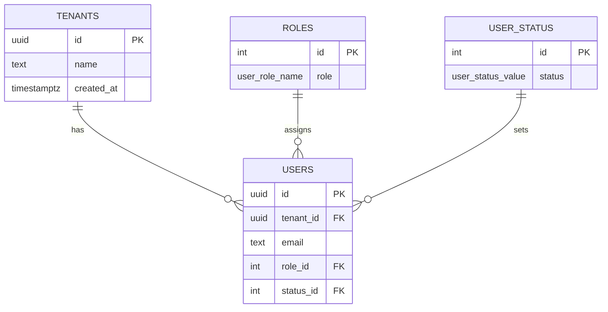
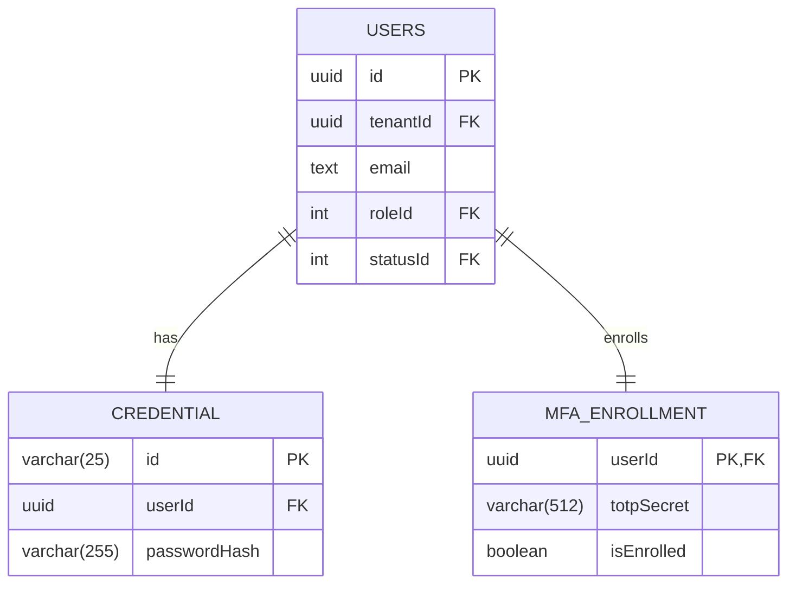

# Shared Team Ticket Journal

This journal records Jira-ticket implementation work from `planning/stackpulse_tax.csv`
and ties each ticket back to the code, tests, and validation evidence produced for it.

## dylan-harle-jira65 - SCRUM-65

**Branch:** `dylan-harle-jira65`

**Owner:** Reyhan Daniels

**Epic:** SCRUM-14 - Secure APIs - Auth, Audit & Boundaries

**Summary:** Create the append-only `audit_entry` table

**CSV Description:** As a Backend Developer, I want an append-only `audit_entry` table,
so that who-did-what-when is recorded immutably per case.

**Acceptance Criteria:**

- A migration creates `audit_entry` with `case_id`, `actor`, `action`, `outcome`,
  and `occurred_at`.
- A database rule or trigger blocks `UPDATE` and `DELETE` on `audit_entry`.
- A test asserts an attempted update fails.

**How This Ties Into the Code:**

- `src/typescript/db/schema.ts` now defines `auditEntry` as a Drizzle table backed by
  `audit_entry`, with `case_id` referencing the generated `tax_plan_cycle.id` case
  identifier established after SCRUM-43/SCRUM-52.
- `src/typescript/db/drizzle-migrations/0002_audit_entry.sql` creates the table,
  per-case read index, foreign key, and an `audit_entry_prevent_mutation` trigger
  function wired by `audit_entry_block_update_delete`.
- `src/typescript/db/seed.ts` includes `audit_entry` in the reset truncation list but
  does not seed audit rows, leaving actual audit writes to later workflow tickets.
- `tests/typescript/audit/auditEntry.test.ts` verifies the table contract, valid
  insert, missing-case FK rejection, and failed `UPDATE`/`DELETE` attempts.
- `adr/0008-append-only-audit-entry.md` records the database-owned append-only audit
  table decision, including the trigger-based immutability boundary and future-ticket
  handoff.
- This ticket does not change JWT issuance, JWT middleware, auth negative paths, or
  FastAPI JWT validation from SCRUM-61 through SCRUM-64. It also does not implement
  stage-transition audit writes from SCRUM-66 or role-gated denied-attempt auditing
  from SCRUM-67.

**Project Scope Connection:**

TaxPulse Advisory requires immutable audit history for case activity. This ticket adds
the database-owned append-only storage foundation for per-case audit evidence while
preserving the current stage-based workflow model and avoiding any dependency on the
separate authentication/JWT chain.

**Changed Files:**

- `package.json`
- `adr/0008-append-only-audit-entry.md`
- `adr/README.md`
- `planning/team/ticket-journal.md`
- `src/typescript/db/drizzle-migrations/0002_audit_entry.sql`
- `src/typescript/db/drizzle-migrations/meta/0002_snapshot.json`
- `src/typescript/db/drizzle-migrations/meta/_journal.json`
- `src/typescript/db/schema.ts`
- `src/typescript/db/seed.ts`
- `tests/typescript/audit/auditEntry.test.ts`

**Validation Notes:**

- `npm run db:gen` could not run in the default sandbox because Node could not resolve
  its install directory due to `EPERM: operation not permitted, lstat
  'C:\Users\Drybones'`; the migration and metadata were added manually in the active
  Drizzle migration path.
- `npm run typecheck` passed with elevated local filesystem access after the same Node
  sandbox permission issue.
- `npm run db:check` passed with elevated local filesystem access.
- `npm run test:migration` ran with elevated local filesystem access; the new
  `tests/typescript/audit/auditEntry.test.ts` passed all 3 tests, and the overall
  suite reported 14 passing tests with 1 existing failure in
  `tests/typescript/tenantsMigration.test.ts` because the configured local PostgreSQL
  database does not provide `uuidv7()`.

## dylan-harle-jira59 - SCRUM-59

**Branch:** `dylan-harle-jira59`

**Owner:** Dylan Harle

**Epic:** SCRUM-14 - Secure APIs - Auth, Audit & Boundaries

**Summary:** Enroll a user in TOTP MFA

**CSV Description:** As a Security Engineer, I want users to enroll a TOTP second
factor, so that login requires more than a password.

**Acceptance Criteria:**

- An enroll endpoint generates a TOTP secret and returns a provisioning URI.
- Enrollment is confirmed by submitting a valid current code before the factor is
  activated.
- The secret is stored in `mfa_enrollment` and the user is marked enrolled.

**How This Ties Into the Code:**

- `mfaEnrollment.ts` defines the enrollment and confirmation schemas, TOTP provider
  boundary, controller behavior, and Problem Details errors for pending enrollment,
  already-enrolled users, invalid codes, and tenant/user mismatches.
- `createDefaultMfaTotpProvider` uses `otplib` to generate a base32 TOTP secret,
  produce an `otpauth://totp/` provisioning URI, and verify submitted current codes.
- `mfaEnrollmentRepository.ts` persists enrollment state through Drizzle against the
  existing `mfa_enrollment` table and verifies tenant isolation through the `users`
  table before any enrollment state is read or written.
- `createMfaEnrollmentRouter` exposes `POST /mfa/enroll` and
  `POST /mfa/enroll/confirm`. The routes accept the `tenant_id` and `user_id`
  returned by the SCRUM-58 `/auth/login` MFA challenge response, while preserving
  `req.tenant` and `req.user` fallback support for future auth middleware.
- `index.ts` wires the MFA router to a database-backed `MfaEnrollmentRepository` when
  `DATABASE_URL` is configured and uses a clearly synthetic local mock repository when
  the database is unavailable, matching the SCRUM-58 local auth fallback.
- `coreCaseOpenApi.ts` documents the MFA enrollment endpoints and shows the login
  challenge identifiers flowing into enrollment and confirmation.
- The implementation does not add a new `users` column or a tenant column on
  `mfa_enrollment`; `mfa_enrollment.isEnrolled` remains the enrollment marker.
- SCRUM-60 still owns the final MFA challenge verification at login and token issuance.

**Project Scope Connection:**

TaxPulse Advisory requires more than a password before authentication completes. This
ticket creates the TOTP enrollment path that stores each user's second factor separately
from profile and password credential data, keeps enrollment tenant-scoped through the
user record, and prepares the login flow for SCRUM-60 without issuing tokens early.

**Changed Files:**

- `package-lock.json`
- `package.json`
- `planning/team/ticket-journal.md`
- `src/typescript/coreCaseOpenApi.ts`
- `src/typescript/index.ts`
- `src/typescript/mfaEnrollment.ts`
- `src/typescript/mfaEnrollmentRepository.ts`
- `src/typescript/mfaEnrollmentRoutes.ts`
- `tests/typescript/coreCaseOpenApi.test.ts`
- `tests/typescript/mfaEnrollment.test.ts`
- `tests/typescript/mfaEnrollmentRoutes.test.ts`

**Validation Notes:**

- `npm install` completed after merging SCRUM-57/58 dependencies so local
  `node_modules` included `argon2` and `otplib`.
- `npm run typecheck` passed.
- `npx vitest run tests/typescript/auth/auth.test.ts tests/typescript/mfaEnrollment.test.ts tests/typescript/mfaEnrollmentRoutes.test.ts tests/typescript/coreCaseOpenApi.test.ts`
  passed with 4 files and 27 tests.
- `npx vitest run --config vitest.integration.config.ts tests/typescript/auth/auth.integration.ts`
  passed with 1 file and 3 tests.
- `npm test` passed typecheck and 77 tests, then failed 1 existing PostgreSQL-backed
  tenant migration test because this local database does not provide `uuidv7()`.
- `npm install` reported existing npm audit findings; no broad dependency remediation
  was performed as part of this ticket.

## dylan-harle-jira60 - SCRUM-60

**Branch:** `dylan-harle-jira60`

**Owner:** Dylan Harle

**Epic:** SCRUM-14 - Secure APIs - Auth, Audit & Boundaries

**Summary:** Challenge and verify the MFA code at login

**CSV Description:** As a Security Engineer, I want login to require a valid TOTP
code, so that a stolen password alone cannot authenticate.

**Acceptance Criteria:**

- After password verification, login requires a second-factor code.
- An invalid or expired code returns 401 and does not issue a token.
- A valid code proceeds to JWT issuance.

**How This Ties Into the Code:**

- `authMfaLogin.ts` adds the second login step for the existing SCRUM-58 password
  flow, consuming `tenant_id`, `user_id`, and a six-digit TOTP code.
- The controller reuses the SCRUM-59 `MfaEnrollmentRepository` and TOTP provider to
  require a tenant-scoped enrolled factor before issuing any token.
- `createHmacJwtIssuer` issues a real HS256 access JWT with `sub`, `tenant_id`,
  `iss`, `iat`, and `exp` claims using `TAXPULSE_JWT_SECRET`,
  `TAXPULSE_JWT_ISSUER`, and `TAXPULSE_ACCESS_TOKEN_TTL_SECONDS`.
- `authMfaLoginRoutes.ts` exposes `POST /auth/login/mfa`, returning one generic
  401 Problem Details response for unknown challenge identifiers, missing or
  unenrolled MFA, and invalid or expired TOTP codes.
- `coreCaseOpenApi.ts` documents the MFA login verification request, bearer token
  response, and validation/authentication failure cases.

**Project Scope Connection:**

TaxPulse Advisory requires password authentication to be insufficient on its own.
This ticket completes the password-to-MFA login path by requiring an enrolled TOTP
factor before access JWT issuance while leaving refresh-token persistence and broader
JWT middleware to SCRUM-61.

**Changed Files:**

- `planning/team/ticket-journal.md`
- `src/typescript/authMfaLogin.ts`
- `src/typescript/authMfaLoginRoutes.ts`
- `src/typescript/coreCaseOpenApi.ts`
- `src/typescript/index.ts`
- `tests/typescript/authMfaLogin.test.ts`
- `tests/typescript/authMfaLoginRoutes.test.ts`
- `tests/typescript/coreCaseOpenApi.test.ts`

**Validation Notes:**

- `npm run typecheck` passed.
- `npx vitest run tests/typescript/auth/auth.test.ts tests/typescript/authMfaLogin.test.ts tests/typescript/authMfaLoginRoutes.test.ts tests/typescript/mfaEnrollment.test.ts tests/typescript/mfaEnrollmentRoutes.test.ts tests/typescript/coreCaseOpenApi.test.ts`
  passed with 6 files and 35 tests.
- `npm test` passed typecheck and 85 tests, then failed 1 existing PostgreSQL-backed
  tenant migration test because this local database does not provide `uuidv7()`.

## christopher-martus-jira61 - SCRUM-61

**Branch:** `christopher-martus-jira61`

**Owner:** Christopher Martus

**Jira Key:** SCRUM-61

**Summary:** Issue access and refresh JWTs with role and tenant claims

**Description:** Issue post-authentication access tokens carrying verified identity claims
and opaque refresh tokens whose SHA-256 hashes are persisted for later revocation.

**Acceptance Criteria:**

- Access JWTs include `sub`, `role`, `tenant_id`, `iss`, `iat`, and `exp`.
- Refresh-token state is persisted without retaining the bearer token value.
- Persisted refresh tokens can be revoked with `revoked_at` recorded.

**Code Connection:**

- `tokenService` accepts only an `AuthenticatedPrincipal`, signs HS256 access JWTs, and
  generates 256-bit opaque refresh tokens.
- `refreshTokenRepository` persists SHA-256 hashes and conditionally records revocation.
- JWT configuration requires one shared issuer and a minimum 32-byte signing secret.
- The SCRUM-60 MFA controller invokes `tokenService.issue({ userId, role, tenantId })`
  after valid TOTP verification using the server-trusted principal loaded from PostgreSQL.
- The trusted MFA lookup joins `user_status` and admits only active users, so disabled
  and invited accounts cannot receive access or refresh tokens.

**Project Scope Connection:**

This establishes a shared identity-token contract for the Node service and future FastAPI
validation while retaining refresh-token revocation state in PostgreSQL and preserving
tenant and role claims from the trusted authentication boundary.

**Changed Files:**

- `src/typescript/authConfig.ts`
- `src/typescript/authMfaLogin.ts`
- `src/typescript/authTypes.ts`
- `src/typescript/coreCaseOpenApi.ts`
- `src/typescript/index.ts`
- `src/typescript/mfaEnrollment.ts`
- `src/typescript/mfaEnrollmentRepository.ts`
- `src/typescript/refreshTokenRepository.ts`
- `src/typescript/tokenService.ts`
- `tests/typescript/authConfig.test.ts`
- `tests/typescript/authMfaLogin.integration.ts`
- `tests/typescript/authMfaLogin.test.ts`
- `tests/typescript/authMfaLoginRoutes.test.ts`
- `tests/typescript/coreCaseOpenApi.test.ts`
- `tests/typescript/mfaEnrollment.test.ts`
- `tests/typescript/mfaEnrollmentRoutes.test.ts`
- `tests/typescript/tokenService.test.ts`
- `tests/typescript/refreshToken.integration.ts`

**Validation Notes:**

- `npm run typecheck` passed.
- `npx vitest run tests/typescript/authConfig.test.ts tests/typescript/tokenService.test.ts`
  passed: 2 files, 11 tests.
- `npm run db:check` passed.
- `npm run test:integration -- tests/typescript/authMfaLogin.integration.ts` passed with
  Docker/Testcontainers access: 1 file, 1 test.
- `npm test` passed 95 of 96 tests with Docker access; the remaining existing
  `tenantsMigration` test fails because legacy migration SQL references `public.roles`
  while the test uses an isolated schema.

## martins-okorie-jira58 - SCRUM-58

**Branch:** `martins-okorie-jira58`

**Owner:** Chimaobi Martins Okorie

**Epic:** SCRUM-14 - Secure APIs — Auth, Audit & Boundaries

**Summary:** Verify password on login

**CSV Description:** As a Security Engineer, I want login to verify the password
against the argon2id hash, so that only valid credentials proceed to the second factor.

**Acceptance Criteria:**

- Login verifies the submitted password against the stored hash.
- A wrong password returns 401 without revealing whether the email exists.
- A correct password advances to the MFA challenge rather than issuing a token directly.

**How This Ties Into the Code:**

- `verifyPasswordHash` wraps Argon2id verification and returns `false` for malformed
  stored values.
- `authModel.ts` holds the password credential and authentication result contracts,
  while `authService.ts` checks submitted login passwords against stored credential
  hashes and returns either `invalid_credentials` or `mfa_challenge_required`.
- `authCredentials.ts` now focuses on Drizzle-backed credential persistence and lookup.
- `createAuthRouter` exposes `POST /auth/login`, validates the submitted `tenant_id`,
  `email`, and `password`, and maps `invalid_credentials` to a shared 401 Problem
  Details response.
- Wrong passwords and unknown emails receive the same 401 response body so the route
  does not disclose whether the email exists.
- Successful password verification returns a 202 MFA challenge payload with no token
  field, leaving token issuance to the later MFA verification step.
- `index.ts` is configured to register the `createAuthRouter` and automatically switch between live database verification and a mock authenticator fallback for local development if the database is unreachable.

**Project Scope Connection:**

TaxPulse Advisory requires password login to be only the first step of authentication.
This route preserves the tenant-scoped auth boundary, avoids account enumeration through
login errors, and advances valid passwords into the MFA flow before any token is issued.

**Changed Files:**

- `README.md`
- `adr/0007-argon2id-password-login.md`
- `adr/README.md`
- `planning/team/ticket-journal.md`
- `src/typescript/authCredentials.ts`
- `src/typescript/authModel.ts`
- `src/typescript/authRoutes.ts`
- `src/typescript/authService.ts`
- `src/typescript/index.ts`
- `tests/typescript/auth/auth.integration.ts`
- `tests/typescript/auth/auth.test.model.ts`
- `tests/typescript/auth/auth.test.ts`

**Validation Notes:**

- `npm run typecheck` passed.
- `npx vitest run tests/typescript/auth/auth.test.ts` passed with 7 unit tests.
- `npx vitest run --config vitest.integration.config.ts tests/typescript/auth/auth.integration.ts`
  passed with 3 route integration tests after granting localhost socket access for the
  ephemeral Express test server.
- `npm test` was run with elevated local socket access; all non-containerized tests
  passed, and the remaining 10 failures were existing Testcontainers-backed table
  contract tests unable to find a working Docker container runtime strategy.
- Wired `createAuthRouter` inside the server's startup script `index.ts`.
- Started development server with `npm run dev` and verified the `/auth/login` endpoint using `curl` and Postman collections, successfully generating a 202 Accepted response for valid mock credentials and a 401 Unauthorized Problem Details response for invalid passwords.

## martins-okorie-jira57 - SCRUM-57

**Branch:** `martins-okorie-jira57`

**Owner:** Chimaobi Martins Okorie

**Epic:** SCRUM-14 - Secure APIs — Auth, Audit & Boundaries

**Summary:** Hash and store passwords with argon2id

**CSV Description:** As a Security Engineer, I want passwords hashed with argon2id on
registration, so that no credential is ever stored in plaintext.

**Acceptance Criteria:**

- Registration hashes the password with argon2id and stores only the hash in the
  credential table.
- The work-factor parameters are configurable and documented.
- A test asserts the stored value is a valid argon2id hash, not the plaintext.

**How This Ties Into the Code:**

- `passwordHashing.ts` provides `hashPassword` to produce encoded Argon2id hashes with
  configurable work-factor parameters, and `verifyPasswordHash` to validate submitted
  passwords against stored hashes (returning `false` for malformed values instead of
  leaking parser errors).
- `authModel.ts` defines the credential and authentication result contracts:
  `PasswordCredentialRegistrationInput`, `StoredPasswordCredential`,
  `PasswordCredentialWriter`, `PasswordCredentialReader`,
  `PasswordCredentialLoginInput`, and the `PasswordAuthenticationResult` union
  (`invalid_credentials` | `mfa_challenge_required`).
- `authService.ts` implements `registerPasswordCredential`, which hashes the submitted
  password via `hashPassword` and delegates persistence to a `PasswordCredentialWriter`,
  and `authenticatePasswordForMfaChallenge`, which verifies login passwords and returns
  `mfa_challenge_required` for valid credentials without minting a token directly.
- `authCredentials.ts` contains `createPasswordCredentialStore`, the concrete Drizzle
  adapter for the `credential` table; its insert row contains `id`, `userId`, and
  `passwordHash`, never the submitted plaintext password. It also re-exports the
  contracts from `authModel.ts` and the service functions from `authService.ts` for
  backward compatibility.
- `resolvePasswordHashingConfig` reads the documented `TAXPULSE_ARGON2_*`
  environment overrides and rejects invalid non-positive or non-integer values.
- Salt length is enforced by generating a per-hash random salt before calling Argon2id.
- The hashing and credential APIs are exported from the TypeScript package boundary
  (`index.ts`) for the registration and login flows.

**Project Scope Connection:**

TaxPulse Advisory's multi-tenant authentication boundary must never store plaintext
credentials. This work gives registration and login a single Argon2id credential
contract with documented work-factor controls, keeps the persisted credential scoped to
the user record, and hands successful password authentication to MFA before any token is
issued.

**Changed Files:**

- `README.md`
- `package-lock.json`
- `package.json`
- `planning/team/ticket-journal.md`
- `src/typescript/authCredentials.ts`
- `src/typescript/authModel.ts`
- `src/typescript/authService.ts`
- `src/typescript/index.ts`
- `src/typescript/passwordHashing.ts`
- `tests/typescript/auth/auth.test.model.ts`
- `tests/typescript/auth/auth.test.ts`

**Validation Notes:**

- `git fetch origin development` and `git merge origin/development` completed before the
  SCRUM-57 service changes, so this branch builds on the latest dev work available at
  the time of implementation.
- `npm run typecheck` passed.
- `npx vitest run tests/typescript/auth/auth.test.ts` passed with 7 unit tests covering
  password hashing, credential registration, MFA challenge flow, and invalid credential
  handling.
- `npm run test` passed typecheck and the SCRUM-57 unit tests, then failed in existing
  Testcontainers-backed credential, MFA, role, and user suites because this environment
  could not find a working container runtime strategy.

## christopher-martus-jira54 - SCRUM-54

**Branch:** `christopher-martus-jira54`

**Owner:** Christopher Martus

**Epic:** SCRUM-13 - Domain Model & Walking Skeleton

**Summary:** Wire read-cycle and cover the create-then-read path

**CSV Description:** As an Advisor, I want to read a created Tax Plan Cycle back through
the API, so that I can confirm the end-to-end spine works.

**Acceptance Criteria:**

- GET by case ID returns the persisted cycle including stage and due_date.
- The create-then-read test confirms the persisted cycle can be fetched back.

**How This Ties Into the Code:**

- `createTaxPlanCycleRouter` serves `GET /tax-plan-cycles/:caseId`, validates the path
  parameter, reads `tenantId` from request context, and delegates to the controller.
- `createTaxPlanCycleCreateController` passes reads through to
  `TaxPlanCycleRepository.findByCaseId` with both the request tenant and generated case
  ID.
- Missing rows and cross-tenant rows return the same 404 Problem Details response, so
  the API does not reveal whether another tenant owns the requested case ID.
- Successful reads return the existing `TaxPlanCycle` JSON shape with `id`,
  `client_id`, `stage`, `priority`, `due_date`, `on_hold`, and optional `hold_reason`.
- The PostgreSQL-backed integration test now creates a cycle through the API, reads it
  back through the GET endpoint, and asserts the returned ID, `stage`, `due_date`, and
  absence of a separate `status` field.
- Cross-tenant integration coverage creates a cycle as one synthetic tenant, attempts
  to read the same case ID as a second synthetic tenant, and verifies the API returns
  the same 404 response used for missing cycles rather than a 403 or existence leak.
- Final contract cleanup documents the GET read response in the README, verifies the
  OpenAPI 200 response includes `stage` and `due_date`, and keeps the contract free of
  a separate cycle `status` field.
- The implementation does not add a separate `status`; workflow condition remains the
  persisted cycle `stage`.

**Project Scope Connection:**

TaxPulse Advisory depends on tenant-scoped Tax Plan Cycle reads so each firm can fetch
only its own cases. This API slice wires the Core Case Service read path to the
repository boundary, preserving tenant isolation and returning the stage-based domain
shape used throughout the workflow.

**Changed Files:**

- `README.md`
- `tests/typescript/coreCaseOpenApi.test.ts`
- `tests/typescript/taxPlanCycleRepository.integration.ts`
- `planning/team/ticket-journal.md`

**Validation Notes:**

- `npm run typecheck` passed.
- `npx vitest run tests/typescript/coreCaseOpenApi.test.ts` passed; 1 file and 6
  tests passed.
- `npm run test:integration -- tests/typescript/taxPlanCycleRepository.integration.ts`
  first failed in the sandbox because Testcontainers could not find a working container
  runtime strategy.
- The same repository integration command passed with Docker/Testcontainers access; 1
  file and 5 tests passed.

## christopher-martus-jira53 - SCRUM-53

**Branch:** `christopher-martus-jira53`

**Owner:** Christopher Martus

**Epic:** SCRUM-13 - Domain Model & Walking Skeleton

**Summary:** Wire create-cycle to persist in Intake stage

**CSV Description:** As an Advisor, I want creating a Tax Plan Cycle to persist it in
Intake, so that a new cycle is recorded against a client and planning period.

**Acceptance Criteria:**

- POST creates a cycle in Intake stage for a given client and planning period and returns
  its case ID.
- A creation also writes the initial stage_transition row.

**How This Ties Into the Code:**

- `TaxPlanCycleRepository.create` now accepts tenant-scoped creation data without a
  caller-selected `stage`.
- Repository create persistence writes `tax_plan_cycle.stage` as `Intake`, stores the
  submitted `due_date`, and returns the generated case ID.
- The same create transaction writes the initial `stage_transition` row for the generated
  case ID.
- Because the current `stage_transition.from_stage` column is non-null, the initial entry
  is represented as `Intake` to `Intake` with the supplied actor and current timestamp.
- `taxPlanCycleCreateSchema` now validates the POST body shape without a caller-selected
  `stage`, while requiring `planning_period`, owner, priority, client ID, and due date.
- `createTaxPlanCycleRouter` reads tenant and actor context, then delegates to the
  repository-backed create controller, which returns the generated `case_id`.
- The legacy repository `insert` path remains for compatibility but also writes `Intake`
  so repository persistence cannot choose a different initial stage.

**Project Scope Connection:**

TaxPulse Advisory starts each tenant-scoped Tax Plan Cycle in Intake so advisors have a
single workflow source of truth in the case stage. This repository slice preserves tenant
isolation and avoids introducing a separate status field while preparing the create-cycle
flow for route/controller wiring and initial transition history.

**Changed Files:**

- `src/typescript/coreCaseOpenApi.ts`
- `src/typescript/index.ts`
- `src/typescript/taxPlanCycle.ts`
- `src/typescript/taxPlanCycleCreateController.ts`
- `src/typescript/taxPlanCycleRepository.ts`
- `src/typescript/taxPlanCycleRoutes.ts`
- `tests/typescript/coreCaseOpenApi.test.ts`
- `tests/typescript/taxPlanCycleRead.typecheck.ts`
- `tests/typescript/taxPlanCycleRepository.integration.ts`
- `tests/typescript/taxPlanCycleRoutes.test.ts`
- `planning/team/ticket-journal.md`

**Validation Notes:**

- `npm run typecheck` passed.
- `npx vitest run tests/typescript/taxPlanCycleRoutes.test.ts tests/typescript/coreCaseOpenApi.test.ts`
  passed; 2 files and 12 tests passed.
- `npm run test:integration -- tests/typescript/taxPlanCycleRepository.integration.ts`
  first failed in the sandbox because Testcontainers could not find a container runtime.
- The same repository integration command passed with Docker/Testcontainers access; 1 file
  and 4 tests passed.

## martins-okorie-jira46 - SCRUM-46

**Branch:** `martins-okorie-jira46`

**Owner:** Chimaobi Martins Okorie

**Epic:** SCRUM-13 - Domain Model & Walking Skeleton

**Summary:** Test the Plan Cycle Queue ordering and overdue flag

**CSV Description:** As a Backend Developer, I want the Plan Cycle Queue query covered
against real PostgreSQL, so that ordering and overdue logic are correct.

**Acceptance Criteria:**

- A query returns a tenant's cases ordered by `due_date` ascending.
- Cases past their `due_date` are flagged overdue in the result.
- A Testcontainers test asserts both ordering and the overdue flag.

**How This Ties Into the Code:**

- `TaxPlanCycleRepository.listQueue` reads tenant-scoped Tax Plan Cycles through
  Drizzle and orders them by `due_date` ascending.
- The queue read model adds `is_overdue`, computed with the SCRUM-46 rule
  `due_date < asOfDate`.
- `TaxPlanCycleQueueInput` accepts the required tenant boundary and an optional
  deterministic `asOfDate` override for tests.
- The Testcontainers integration suite inserts synthetic queue data for two tenants
  and verifies ordering, tenant isolation, and overdue flags against PostgreSQL.

**Project Scope Connection:**

TaxPulse Advisory uses the Plan Cycle Queue to help advisors scan tenant-scoped cases
by upcoming due date. This ticket protects that workflow by proving the queue reads the
right firm's cases in the right order and clearly marks overdue Tax Plan Cycles without
introducing a separate case status field.

**Changed Files:**

- `src/typescript/taxPlanCycleRepository.ts`
- `src/typescript/index.ts`
- `tests/typescript/taxPlanCycleRepository.integration.ts`
- `tests/typescript/taxPlanCycleRead.typecheck.ts`
- `planning/team/ticket-journal.md`

**Validation Notes:**

- `npm run typecheck` passed.
- `npm test` passed with local socket permissions; 8 files and 49 tests passed.
- `npm run test:migration` passed with local PostgreSQL socket permissions; 7 tests
  passed.
- `npm run db:check` passed.
- `npm run test:integration` is wired for the SCRUM-46 Testcontainers coverage but
  could not run in this shell because Testcontainers could not find a working container
  runtime strategy.

## martins-okorie-jira33 - SCRUM-33

**Branch:** `martins-okorie-jira33`

**Owner:** Chimaobi Martins Okorie

**Epic:** SCRUM-12 - Engineering Foundations & Federal Posture

**Summary:** Surface aggregation timeouts as rejected promises

**CSV Description:** As a Backend Developer, I want a simulated source timeout surfaced
as a rejected promise, so that the Data Aggregation stage never hangs on a slow source.

**Acceptance Criteria:**

- The client races the source call against a configurable timeout.
- A simulated timeout rejects with a typed timeout error rather than hanging.
- A Vitest case asserts the rejection and that a fast call still resolves.

**How This Ties Into the Code:**

- `TaxPulseAggregationClient` now accepts optional timeout configuration while keeping
  the existing constructor call shape valid.
- Aggregation fetches race the source promise against a timeout promise and reject with
  `AggregationTimeoutError` when the timeout wins.
- The timeout error carries the affected `clientId` and configured `timeoutMs` for
  typed handling by callers and tests.
- `tests/typescript/aggregationClient.test.ts` verifies both the timeout rejection and
  the fast-source success path with deterministic fake timers.

**Tradeoffs:**

- Timeout handling rejects the client call but does not cancel the underlying
  data-source promise because the current source interface has no abort signal.
- Constructor-level timeout configuration preserves existing callers while making the
  timeout configurable for slow-source simulations.
- A `1000ms` default prevents hangs without making local mock behavior brittle.

**Project Scope Connection:**

TaxPulse Advisory depends on the Data Aggregation stage to gather client income and
deduction information without blocking the Tax Plan Cycle workflow. This ticket keeps a
slow simulated source from hanging aggregation work, which protects stage progression and
maintains predictable backend behavior for tenant-scoped planning workflows.

**Changed Files:**

- `src/typescript/aggregationClient.ts`
- `src/typescript/index.ts`
- `tests/typescript/aggregationClient.test.ts`
- `planning/team/ticket-journal.md`

**Validation Notes:**

- `npm run typecheck` passed.
- `npx vitest run tests/typescript/aggregationClient.test.ts` passed.
- `npm test` was rerun with local socket permissions; all non-migration suites passed
  with 41 tests, but the migration suites require `DATABASE_URL` in this local
  environment.

## martins-okorie-jira43 - SCRUM-43

**Branch:** `martins-okorie-jira43`

**Owner:** Chimaobi Martins Okorie

**Epic:** SCRUM-13 - Domain Model & Walking Skeleton

**Summary:** Create the `stage_transition` table

**CSV Description:** As a Backend Developer, I want a `stage_transition` table, so that
every stage change on a Tax Plan Cycle is recorded.

**Acceptance Criteria:**

- A migration creates `stage_transition` with `case_id` FK, `from_stage`, `to_stage`,
  `actor`, and `occurred_at`.
- A foreign key ties each transition to its `tax_plan_cycle`.
- An index on `case_id` supports reading a case's transition history.

**How This Ties Into the Code:**

- `migrations/20260626120000_create_tax_plan_cycle.sql` now creates the
  `stage_transition` table after `tax_plan_cycle`.
- `stage_transition.case_id` references `tax_plan_cycle.client_id`, matching the current
  Tax Plan Cycle primary key.
- `from_stage` and `to_stage` use check constraints with the same seven canonical
  workflow stages as `tax_plan_cycle.stage`.
- `stage_transition_case_id_idx` supports reading transition history by case.
- `tests/typescript/taxPlanCycleMigration.test.ts` verifies the table shape, FK, stage
  checks, index, valid transition insert/read, missing-case rejection, and invalid-stage
  rejection.
- `vitest.config.ts` no longer excludes the migration test, so `npm run test:migration`
  reaches the intended test file.

**Project Scope Connection:**

TaxPulse Advisory is built around a Tax Plan Cycle that moves through defined workflow
stages with role-gated transitions and immutable audit history. This ticket supports
that scope by creating the database table that records every stage change for a cycle.
That transition history is a foundation for reviewer visibility, compliance evidence,
and the archived audit trail described in the project scope.

**Changed Files:**

- `migrations/20260626120000_create_tax_plan_cycle.sql`
- `tests/typescript/taxPlanCycleMigration.test.ts`
- `vitest.config.ts`

**Validation Notes:**

- `npm run typecheck` passed.
- `npm run test:migration` now starts and reaches
  `tests/typescript/taxPlanCycleMigration.test.ts`, but this local environment needs
  `DATABASE_URL` set before the PostgreSQL migration test can execute.

## dylan-harle-jira48 - SCRUM-48

**Branch:** `dylan-harle-jira48`

**Owner:** Dylan Harle

**Epic:** SCRUM-13 - Domain Model & Walking Skeleton

**Summary:** Add the create-cycle route with zod validation

**CSV Description:** As a Backend Developer, I want a create-cycle route validated with
zod, so that malformed Tax Plan Cycle creates are rejected at the boundary.

**Acceptance Criteria:**

- A POST route validates the create body against the Tax Plan Cycle create schema.
- A malformed request returns 400 with a structured validation error.
- A valid request reaches the controller layer with no persistence yet.

**How This Ties Into the Code:**

- `createApp` now owns JSON body parsing before registered feature routes, so the
  create-cycle endpoint runs through the SCRUM-47 Express skeleton instead of a
  route-only test harness.
- `main` registers `createTaxPlanCycleRouter` through `createApp`, connecting the
  no-persistence create endpoint to the Core Case Service HTTP surface.
- Malformed create bodies are raised as `ProblemHttpError` instances and returned by
  the shared RFC 7807 Problem Details middleware with validation issues attached as
  safe extension data.
- Controller failures also flow through the same Problem Details middleware, while
  valid creates still reach the controller stub and return the accepted response.
- `tests/typescript/taxPlanCycleRoutes.test.ts` boots the route through `createApp`
  to verify JSON parsing, shared error handling, and controller delegation together.

**Project Scope Connection:**

TaxPulse Advisory centers work around the Tax Plan Cycle. This ticket adds the first
write-side HTTP boundary for creating a cycle while preserving the project constraints
that workflow state remains in the case stage and malformed boundary input is rejected
before it can affect downstream case, tenant, audit, or persistence behavior.

**Changed Files:**

- `package-lock.json`
- `src/typescript/app.ts`
- `src/typescript/errors.ts`
- `src/typescript/index.ts`
- `src/typescript/taxPlanCycleRoutes.ts`
- `tests/typescript/taxPlanCycleRoutes.test.ts`
- `planning/team/ticket-journal.md`

**Validation Notes:**

- `npm install` completed and installed the SCRUM-47 logging dependencies declared in
  `package.json`.
- `npm run typecheck` passed.
- `npm test` passed, including smoke tests and Vitest coverage for the health
  endpoint, pino request logging, Problem Details middleware, and the create-cycle
  route through `createApp`.

## dylan-harle-jira49 - SCRUM-49

**Branch:** `dylan-harle-jira49`

**Owner:** Dylan Harle

**Epic:** SCRUM-13 - Domain Model & Walking Skeleton

**Summary:** Add the read-cycle route

**CSV Description:** As a Backend Developer, I want a read-cycle route by case ID, so
that a created Tax Plan Cycle can be fetched back.

**Acceptance Criteria:**

- A GET route accepts a case ID path parameter and validates it.
- An unknown case ID returns 404 as Problem Details.
- The route is tenant-scoped via the request's tenant context.

**How This Ties Into the Code:**

- `taxPlanCycleSchema` uses `client_id` as the Tax Plan Cycle unit-of-work identifier
  exposed through the current `caseId` route parameter.
- `tax_plan_cycle` follows the SCRUM-42 table shape without a separate `case_id`
  column, while transition history still uses the SCRUM-43 `stage_transition.case_id`
  column to reference `tax_plan_cycle.client_id`.
- `createTaxPlanCycleRouter` now serves `GET /tax-plan-cycles/:caseId`, validates
  the path parameter with zod, reads tenant scope from `req.tenant.id`, and delegates
  to `findByCaseId({ tenantId, caseId })`.
- Missing or cross-tenant cycles return the shared RFC 7807 Problem Details response
  with a 404 status, preserving tenant isolation by not revealing cross-tenant
  existence.

**Project Scope Connection:**

TaxPulse Advisory centers work around tenant-scoped Tax Plan Cycles. This ticket adds
the read-side HTTP boundary needed to fetch a cycle by its case identifier while
preserving stage-based workflow state, tenant isolation, and the shared Problem
Details error contract.

**Changed Files:**

- `migrations/20260626120000_create_tax_plan_cycle.sql`
- `src/typescript/index.ts`
- `src/typescript/taxPlanCycle.ts`
- `src/typescript/taxPlanCycleCreateController.ts`
- `src/typescript/taxPlanCycleRoutes.ts`
- `tests/typescript/smoke.test.ts`
- `tests/typescript/taxPlanCycle.test.ts`
- `tests/typescript/taxPlanCycleMigration.test.ts`
- `tests/typescript/taxPlanCycleRoutes.test.ts`
- `planning/team/ticket-journal.md`

**Validation Notes:**

- `npm run typecheck` passed.
- `npm test` passed.
- `npm run test:migration` did not execute the migration test because the current
  `vitest.config.ts` explicitly excludes `tests/typescript/taxPlanCycleMigration.test.ts`;
  Vitest exited with "No test files found."

## development - SCRUM-50

**Branch:** `development`

**Owner:** Reyhan Daniels

**Epic:** SCRUM-13 - Domain Model & Walking Skeleton

**Summary:** Publish the OpenAPI document for create and read

**CSV Description:** As a Backend Developer, I want an OpenAPI description of the
create and read operations, so that the contract is published before clients consume it.

**Acceptance Criteria:**

- An OpenAPI document describes the create and read operations with their
  request/response schemas.
- The document is served at a documented path and validates against the OpenAPI spec.

**How This Ties Into the Code:**

- `createCoreCaseOpenApiDocument` publishes an OpenAPI 3.0.3 document for
  `POST /tax-plan-cycles` and `GET /tax-plan-cycles/{caseId}`.
- The document derives Tax Plan Cycle request, read parameter, and read response schemas
  from the same Zod definitions used by the route boundary.
- The create acknowledgment response now has a small Zod schema source so the OpenAPI
  response schema is not maintained as an unrelated hand-written contract.
- `createCoreCaseOpenApiRouter` serves the document at `GET /openapi.json`, and service
  startup registers it with the existing Core Case Service routes.
- `README.md` documents the OpenAPI path and the covered create/read operations.
- `tests/typescript/coreCaseOpenApi.test.ts` verifies the served document, operation
  coverage, schema contents, source schema registrations, and local OpenAPI structure.

**Project Scope Connection:**

TaxPulse Advisory exposes tenant-scoped Tax Plan Cycle operations to client teams.
Publishing the create/read OpenAPI contract gives client teams a stable, documented
boundary while preserving tenant isolation language, the stage-based workflow model,
and fake-only synthetic examples.

**Changed Files:**

- `README.md`
- `planning/team/ticket-journal.md`
- `src/typescript/coreCaseOpenApi.ts`
- `src/typescript/coreCaseOpenApiRoutes.ts`
- `src/typescript/index.ts`
- `src/typescript/taxPlanCycleCreateController.ts`
- `tests/typescript/coreCaseOpenApi.test.ts`

**Validation Notes:**

- `npm run typecheck` passed.
- `npm test` passed, including the OpenAPI document tests.
- `python -m ruff format --check src/python tests/python` passed.
- `python -m pytest` passed with 4 tests; pytest emitted a local cache warning because
  it could not write under `.pytest_cache`.

## martins-okorie-jira51 - SCRUM-51

**Branch:** `martins-okorie-jira51`

**Owner:** Chimaobi Martins Okorie

**Epic:** SCRUM-13 - Domain Model & Walking Skeleton

**Summary:** Define the Drizzle schema for the Tax Plan Cycle tables

**CSV Description:** As a Backend Developer, I want Drizzle schema definitions matching
the PostgreSQL tables, so that persistence is type-safe and migration-driven.

**Acceptance Criteria:**

- Drizzle definitions match the tenant, tax_plan_cycle, and stage_transition tables.
- A generated migration creates the tables from empty and matches the hand-written
  migrations.
- Running migrations is idempotent and recorded in a migrations table.

**How This Ties Into the Code:**

- `src/typescript/db/schema.ts` defines exported Drizzle tables for `tenants`,
  `tax_plan_cycle`, and `stage_transition` with the intended columns, constraints,
  indexes, and foreign keys.
- `drizzle.config.ts` points Drizzle Kit at the TypeScript schema and writes generated
  migration evidence into `drizzle/`.
- `migrations/20260626120000_create_tax_plan_cycle.sql` now matches SCRUM-42 by
  focusing on `tax_plan_cycle`, while `migrations/20260627120000_create_stage_transition.sql`
  keeps the SCRUM-43 transition history DDL in its own migration.
- `stage_transition.case_id` remains a foreign key to the generated `tax_plan_cycle.id`
  case identifier.
- `applyMigrations` now creates `schema_migrations`, records applied SQL files, and
  skips already-applied migrations so reruns are idempotent.
- Migration tests verify the table contract, Drizzle-generated SQL evidence, migration
  tracking, idempotent reruns, and the foreign key/check-constraint behavior.

**Project Scope Connection:**

TaxPulse Advisory centers work on tenant-scoped Tax Plan Cycles with stage-based
workflow state and durable transition history. This ticket gives the Core Case Service
a typed Drizzle schema for those persistence tables while preserving tenant isolation,
the no-separate-status rule, and migration evidence needed for a defensible walking
skeleton.

**Changed Files:**

- `README.md`
- `drizzle.config.ts`
- `drizzle/`
- `migrations/20260625120000_create_tenants.sql`
- `migrations/20260626120000_create_tax_plan_cycle.sql`
- `migrations/20260627120000_create_stage_transition.sql`
- `package-lock.json`
- `package.json`
- `src/typescript/db/schema.ts`
- `src/typescript/index.ts`
- `src/typescript/postgresMigrations.ts`
- `tests/typescript/taxPlanCycleMigration.test.ts`
- `tests/typescript/tenantsMigration.test.ts`
- `planning/team/ticket-journal.md`

**Validation Notes:**

- `npm run typecheck` passed.
- `npm run db:check` passed.
- `npm run db:generate` created the Drizzle migration evidence; a second run reported
  no schema changes.
- `npm test` passed with local socket permissions; 8 files and 49 tests passed.
- `npm run test:migration` passed with local PostgreSQL socket permissions; 7 tests
  passed.
- The handwritten stage transition migration was split into its own idempotent file
  for readability while preserving the existing table shape.
- Python validation commands could not run in this shell because `python`/`python3`
  are Python 3.13.2 and do not have Ruff, Pyright, or pytest installed, while
  `pyproject.toml` requires Python 3.13.14 exactly.

## dylan-harle-jira52 - SCRUM-52

**Branch:** `dylan-harle-jira52`

**Owner:** Dylan Harle

**Epic:** SCRUM-13 - Domain Model & Walking Skeleton

**Summary:** Implement the Tax Plan Cycle repository through Drizzle

**CSV Description:** As a Backend Developer, I want a repository that inserts and reads
a Tax Plan Cycle through Drizzle, so that the service persists cases via one typed
boundary.

**Acceptance Criteria:**

- A repository method inserts a cycle and returns its generated case ID.
- A repository method reads a cycle back by case ID within the tenant scope.
- A Testcontainers test covers insert-then-read through Drizzle.

**How This Ties Into the Code:**

- `tax_plan_cycle.id` is now the generated primary key and the service-facing case ID.
- `tax_plan_cycle.client_id` remains a required client reference, but it is no longer
  the cycle primary key or the target of transition history.
- `stage_transition.case_id` now references `tax_plan_cycle.id`.
- `TaxPlanCycle` read models include generated `id`, while create payloads omit it.
- `createTaxPlanCycleRepository` inserts through Drizzle, returns the generated `id`,
  and reads by `{ tenantId, caseId }` using the new primary key.
- `createTaxPlanCycleReadHelper` remains as a compatibility wrapper for existing route
  code.

**Project Scope Connection:**

TaxPulse Advisory centers work around tenant-scoped Tax Plan Cycles with durable stage
history. This ticket removes the temporary `client_id`-as-case-ID assumption and gives
future case, transition, audit, and read-model work a stable generated cycle key while
preserving tenant-scoped reads.

**Changed Files:**

- `drizzle/`
- `migrations/20260626120000_create_tax_plan_cycle.sql`
- `seed.sql`
- `src/typescript/coreCaseOpenApi.ts`
- `src/typescript/db/schema.ts`
- `src/typescript/index.ts`
- `src/typescript/taxPlanCycle.ts`
- `src/typescript/taxPlanCycleRepository.ts`
- `tests/typescript/smoke.test.ts`
- `tests/typescript/taxPlanCycle.test.ts`
- `tests/typescript/taxPlanCycleMigration.test.ts`
- `tests/typescript/taxPlanCycleRead.typecheck.ts`
- `tests/typescript/taxPlanCycleRepository.integration.ts`
- `tests/typescript/taxPlanCycleRoutes.test.ts`

**Validation Notes:**

- `npm install` restored declared dependencies, including `drizzle-orm`, into
  `node_modules`.
- `npm run typecheck` passed.
- `npx vitest run tests/typescript/aggregationClient.test.ts tests/typescript/coreCaseOpenApi.test.ts tests/typescript/httpApp.test.ts tests/typescript/taxPlanCycle.test.ts tests/typescript/taxPlanCycleRoutes.test.ts tests/typescript/taxPlanCycleTransitions.test.ts`
  passed with 41 tests.
- `npm run test:integration` passed with 2 Testcontainers repository tests.
- `npm run test:smoke` passed with 9 tests.
- `npm run db:check` passed.
- `npm test` still fails in this local environment when migration tests use the
  configured `DATABASE_URL` because that PostgreSQL instance does not provide
  `uuidv7()`.

## caleb-latimer-jira55 - SCRUM-55

**Branch:** `caleb-latimer-jira55`

**Owner:** Caleb Latimer

**Epic:** SCRUM-14 - Secure APIs - Auth, Audit & Boundaries

**Summary:** Create the user and role tables

**CSV Description:** As a Backend Developer, I want user and role tables, so that
TaxPulse identities and their roles are stored per tenant.

**Acceptance Criteria:**

- A migration creates a `user` table with `tenant_id`, `email` unique per tenant, and
  `status`.
- A `role` table enumerates Firm Admin, Advisor, Client, and TaxPulse Platform Admin.
- A `user_status` table enumerates invited, active, and disabled.
- A user is assigned exactly one role and one status via foreign keys.

**How This Ties Into the Code:**

- `src/typescript/db/schema.ts` now defines `role`, `user_status`, and `user`
  alongside the existing tenant and cycle tables.
- `role.role` is modeled as a Postgres enum-backed lookup column for the four canonical
  role labels, while `user_status.status` captures the three account lifecycle states.
- `role.id` and `user_status.id` now use integer identity primary keys, and `users`
  points at both lookup tables through `role_id` and `status_id`.
- The Mermaid ER diagram for the auth lookup tables is:

**Project Scope Connection:**

TaxPulse Advisory needs tenant-isolated identities before the auth, roster, and JWT
work can land. This ticket creates the persistence boundary for firm staff, clients,
and platform admins while preserving least-privilege, scoped access, and the project
rule that workflow condition stays in the Tax Plan Cycle stage rather than in a
separate case status field.

**Changed Files:**

- `drizzle/0001_user_role.sql`
- `drizzle/meta/_journal.json`
- `drizzle/meta/0000_snapshot.json`
- `src/typescript/db/schema.ts`
- `src/typescript/index.ts`
- `tests/typescript/userRoleMigration.test.ts`
- `planning/prompt-journal/cl-journal.md`
- `planning/team/ticket-journal.md`

**Validation Notes:**

- Implementation was completed in the workspace.
- Review action items:
  - `npm run db:check`
- `npm run typecheck`
- `npm test`
- `npm run test:migration`

## caleb-latimer-jira56 - SCRUM-56

**Branch:** `caleb-latimer-jira56`

**Owner:** Caleb Latimer

**Epic:** SCRUM-14 - Secure APIs - Auth, Audit & Boundaries

**Summary:** Create the credential and mfa_enrollment tables

**CSV Description:** As a Backend Developer, I want credential and mfa_enrollment
tables, so that password hashes and second factors are stored apart from user profile
data.

**Acceptance Criteria:**

- A Drizzle migration creates a `credential` table keyed to a user with a CUID primary
  key and an argon2id password hash column.
- A Drizzle migration creates an `mfa_enrollment` table with a per-user TOTP secret
  and enrolled flag.
- Neither table stores a plaintext password or recovery code.

**How This Ties Into The Code:**

- `src/typescript/db/schema.ts` now defines `credential` and `mfa_enrollment` with
  camelCase TypeScript field names, matching the repo's TypeScript default style.
- `credential` stores `id`, `userId`, and `passwordHash`, while `mfa_enrollment`
  stores `userId`, `totpSecret`, and `isEnrolled` with a `false` default.
- `src/typescript/db/seed.ts` now seeds synthetic credential hashes and TOTP secrets
  alongside the existing tenant, user, role, and cycle fixtures.
- `tests/typescript/credential/*` and `tests/typescript/mfa_enrollement/*` now cover
  the table contracts, seeded rows, FK enforcement, and one-row-per-user behavior.
- `package.json` wires the new auth schema tests into `npm run test:migration` so the
  dedicated migration suite exercises the new tables with the existing repository
  contracts.
- The Mermaid ER diagram for the auth storage split is:

**Project Scope Connection:**

TaxPulse Advisory keeps credentials and second factors out of the user profile record
so identity data, password hashes, and MFA enrollment can evolve independently while
preserving least privilege and the project's audit-friendly auth boundary.

**Changed Files:**

- `package.json`
- `planning/prompt-journal/cl-journal.md`
- `planning/team/ticket-journal.md`
- `src/typescript/db/schema.ts`
- `src/typescript/db/seed.model.ts`
- `src/typescript/db/seed.ts`
- `src/typescript/index.ts`
- `tests/typescript/credential/credential.integration.ts`
- `tests/typescript/credential/credential.test.model.ts`
- `tests/typescript/credential/credential.test.ts`
- `tests/typescript/mfa_enrollement/mfa_enrollement.integration.ts`
- `tests/typescript/mfa_enrollement/mfa_enrollement.test.model.ts`
- `tests/typescript/mfa_enrollement/mfa_enrollement.test.ts`

**Validation Notes:**

- Schema, seed, and test scaffolding were added in the workspace.
- Drizzle generation and Node-based validation were left as follow-up action items per
  the user's request not to run node scripts in this turn.
